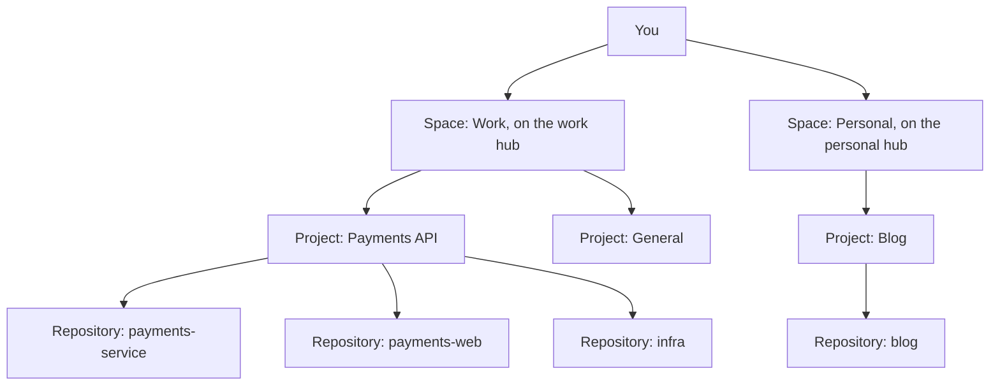
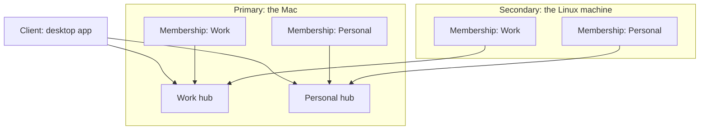
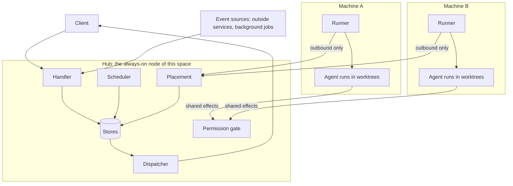
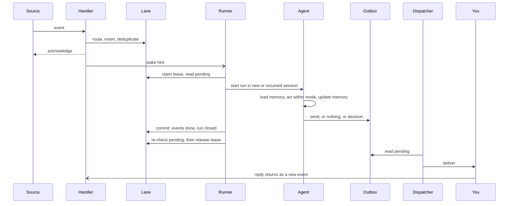
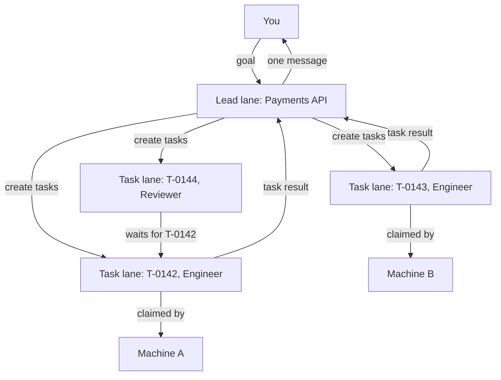
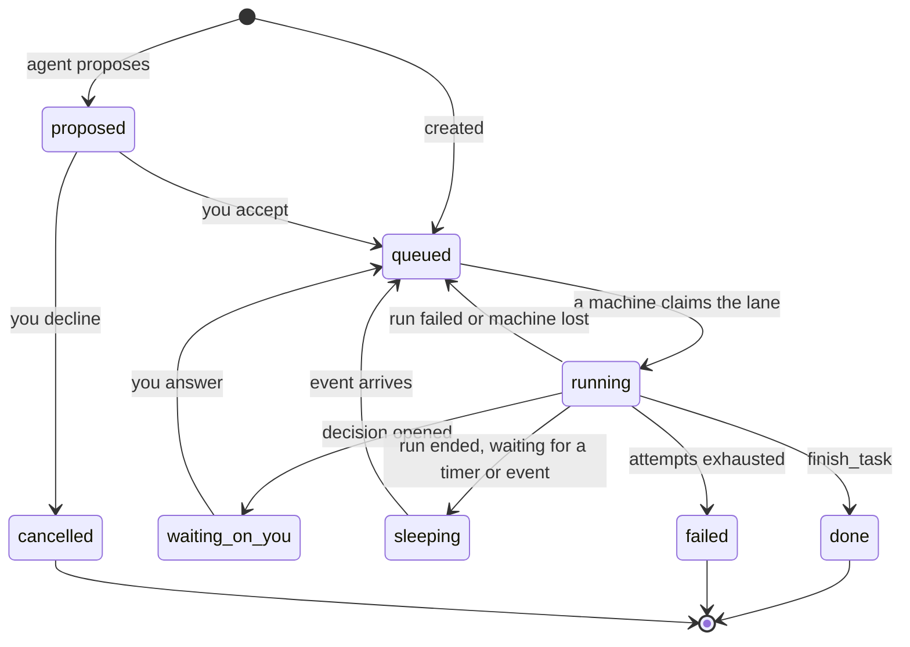
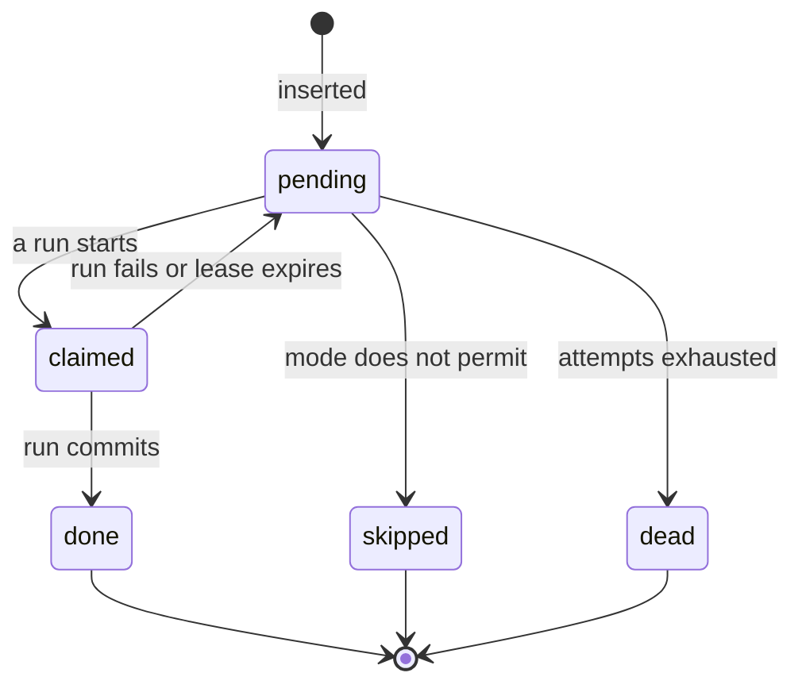
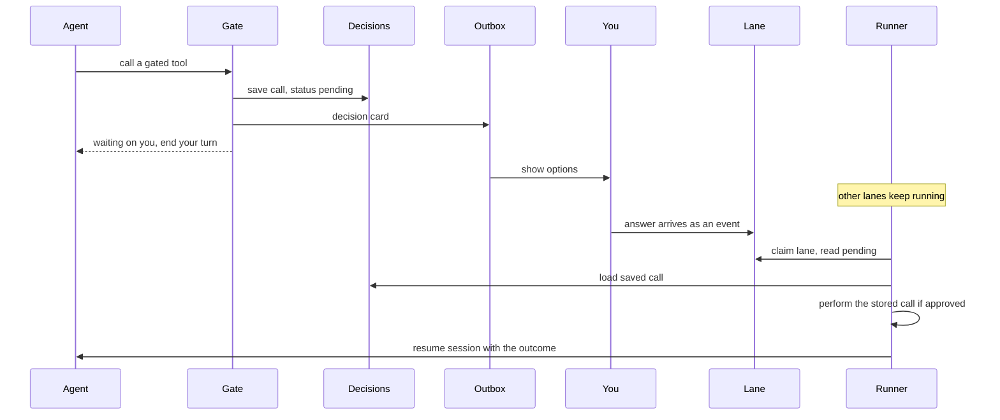

# Threadlane: System Design and Implementation Plan

Threadlane is an always-on team of agents for one person, running across that person's own computers.

Sources:

- [Building always-on agents](https://claude.com/resources/articles/building-always-on-agents) (Anthropic, Nov 2026): the five primitives and the run cycle.
- [Noop](https://github.com/huacnlee/noop): prior art for running a team of agents across your own machines.

This document defines the ideology, architecture, data model, behavior, and build order. It started language-agnostic and the design is still written that way, but the main technology choices are now made: Rust, iroh, Turso, the Claude and Codex command-line agents, `gh`, and GPUI Kit for the client. Section 18 lists them and what each changes. Wireframes for the client are in [`wireframes.html`](wireframes.html).

**How to read this document.**

- Sections 4 and 6 to 10 follow the article. Unmarked statements there come from it.
- Sections 2 and 5 (projects, agents, modes, tasks, machines) are this plan's own design. The article does not cover them.
- Paragraphs marked **Decision** are choices this plan makes where the article offers options or says nothing.
- Notes marked **From Noop** credit an idea borrowed from it.
- Numeric defaults are starting points to tune.

---

## 1. Ideology

### 1.1 The core idea

An always-on agent is not always on. It is asleep almost all the time and wakes briefly to do work. "Always on" describes the user experience, not the runtime.

The agent loop is the same loop every other agent uses. What makes it always-on is the architecture around the loop, which answers three questions:

1. **When does an agent wake up?** Event inbox and timers.
2. **What carries over between wake-ups?** Memory and sessions.
3. **How does its work reach you, and what may it do unattended?** Outbox and permissions.

### 1.2 What this system is

One person. Separate spaces. Many projects. Several agents. Several computers.

- **Single user.** There is one owner. No accounts, teams, or sharing.
- **Separate spaces.** Work and personal are separate spaces. Each space is its own hub with its own stores, and the hubs know nothing of each other.
- **Many projects.** Each space holds projects, and each project holds one or more repositories.
- **Several agents.** Each agent has a role. In each project you choose how much each agent may start and do without asking.
- **Several machines.** Any of your computers can join a space. Tasks run in parallel across them. A computer can join more than one space.
- **One client.** A desktop app first, a phone app later, paired with every space and showing them together. There is no browser client.

### 1.3 Vocabulary

| Term | Meaning |
|---|---|
| **Space** | One hub and everything it holds, for example Work or Personal. The isolation boundary. |
| **Hub** | The always-on node of one space. Holds that space's stores and coordinates its work. |
| **Project** | A unit of work inside a space. Holds repositories, agent settings, memory, and tasks. |
| **Repository** | A source repository registered to exactly one project. |
| **Agent** | A configured role: instructions, backend, model, tools. |
| **Backend** | The command-line agent that executes an agent's runs: Claude or Codex. |
| **Mode** | How much an agent may start and do without asking, set per project. |
| **Lead** | The agent that talks to you in a project, breaks goals into tasks, and decides what to tell you. |
| **Task** | A unit of work in a project, assigned to one agent. |
| **Machine** | A computer that can execute runs. |
| **Membership** | One machine's place in one space: its own key, files, and limits there. |
| **Event** | Something that happened and may need attention: a message from you, something pulled from an outside service, a fired timer, a task result, an answer to a decision. |
| **Lane** | One slice of the inbox with at most one active run. One per project lead and one per task. |
| **Run** | One stretch of work: receive events, do the task, save what happened, go back to sleep. |
| **Session** | The transcript of messages and tool calls that a run works inside. Can span many runs. |
| **Timer** | A future wake-up: a one-off follow-up or a recurring routine. |
| **Memory** | Durable files agents read and write to keep continuity across runs. |
| **Decision** | A paused tool call shown to you as a short list of options. |
| **Outbox** | Durable list of outgoing messages, delivered by a dispatcher. |

### 1.4 Principles

When a design question comes up later, resolve it against this list.

1. **Durable state is the truth; processes and machines are disposable.** Any process or machine can vanish at any instant, and another must be able to continue from the hub's stores.
2. **Sources never call an agent.** Everything that wants attention writes an event to the inbox. There is exactly one way in.
3. **Wake-ups are hints.** A wake signal only says "look at the inbox". The runner always pulls the latest state.
4. **One active run per lane.** Parallelism comes from having many lanes, never from two runs in one lane.
5. **The inbox holds only work that is ready.** Anything meant for the future lives in the timer store.
6. **Memory holds only what cannot be looked up again.** If it lives in another system, store a pointer.
7. **Anything that must survive goes to memory.** Transcripts get compacted or rotated, and a task may resume on a different machine.
8. **Agents run as you.** There is no sandbox. An agent has your network access, files, and logins, as when you run the same tool yourself.
9. **Local work is free; shared effects go through the gate.** An agent works freely in its own worktree. Anything another person or system can see is done through the system's tools, which pass the hub's gate. This is a rule agents are set up to follow, not a wall (section 9.2).
10. **A mode sets both initiative and authority.** What an agent may start and what it may do are chosen together, per project, per agent.
11. **Spaces share nothing the system holds.** Each space is a separate hub with separate stores and keys. Hubs never connect to each other. The only places spaces meet are your client and any login you choose to use in more than one space, such as one GitHub account (section 9.3).
12. **Machines only connect outward and are never waited for.** They help when online. Work does not stall because one is asleep.
13. **Quiet by default.** You hear about results and decisions, nothing else.
14. **Keep the fixed context lean.** System prompt, tool definitions, and preloaded memory are paid for on every run.

---

## 2. Organization model

### 2.1 Spaces, projects, repositories



- **Space.** One hub. Holds the settings its projects inherit: mode ceiling, quiet hours. Its model accounts are the ones its machines are logged in to (section 5.3). The machines that have joined it are the only ones that can run its work. It is the isolation boundary (principle 11).
- **Project.** Holds repositories, per-agent modes, memory, tasks, and routines. May override any space default with a stricter value.
- **Repository.** Belongs to exactly one project, so an event about a repository always has one unambiguous destination.

**Decisions:**

- **One hub per space.** A space is not a label inside a shared database; it is a complete, separate instance of the system. Reasons:
  - *Isolation by construction.* There is no code path from one space's data to another's, so there is no check to get wrong.
  - *Each space's material rests only where that space lives.* A work hub on a work computer keeps work transcripts, checkpoints, and memory off personal devices (section 3.6).
  - *A simpler core.* Nothing in a hub's schema or logic mentions spaces. A hub serves exactly one.
  - *It scales by addition.* A third space, such as a client engagement, is one more hub. Load, failure, and retention are separate per space.
- **What it costs.** Every hub needs a computer that stays on, and a hub that sleeps pauses its space (section 5.9). Agents and settings are defined per space. A machine in two spaces splits its capacity between them (section 5.3).
- **One computer may host more than one hub.** Each hub is an instance with its own data directory and key. Hosting two on one computer gives up the device separation but keeps everything else. A hub moves to another computer by moving its data directory and key.
- **Starting setup.** Two computers, a Mac and a Linux machine. One is the primary and hosts every hub; the other joins each space as a machine. Either may be the primary, so the hub and the runner both run on macOS and on Linux, and a hub can be moved from one to the other. Windows is not scheduled.
- **Every space has a built-in General project** with no repositories, for requests not tied to a repository. Every message therefore belongs to a project, and no agent ever needs to see across all projects.
- **The combined view is a client feature, not an agent.** The home screen aggregates decisions and activity from every project in every paired space (section 11.3). No single run reads more than one project, and no hub reads more than one space.

### 2.2 Agents and bindings

An **agent** is defined once per space: name, role, instructions, backends, models, tool set. Examples: Lead, Engineer, Reviewer, Researcher. The set is yours to define. An Engineer in Work and an Engineer in Personal are separate definitions; the client can copy one to another space when you ask it to.

A **binding** connects an agent to a project and carries its settings there: mode, model override, parallel limit, per-action overrides.

Every project has exactly one **lead** binding. The lead is an ordinary agent whose lane is the project's conversation with you.

**From Noop:** a team with roles, where each member has a model and a level of independence.

### 2.3 Modes

A mode answers two questions at once: what may this agent **start**, and what may it **do** without asking.

| Mode | Initiative | Authority |
|---|---|---|
| **Off** | Never runs in this project. | None. |
| **On request** | Starts work only when you ask. | Reads and works locally. Asks before any shared effect. |
| **Assisted** | Also notices things and **proposes** work. You accept a proposal to start it. | Also makes shared, reversible changes after automatic review. Asks for anything hard to undo. |
| **Autonomous** | Starts work on its own from events, routines, and its own follow-ups. | Also performs hard-to-undo actions you have granted a standing rule for. Asks for the rest. |

Actions are sorted into tiers:

| Tier | Meaning | Examples |
|---|---|---|
| 0 | Read | Read a repository, search, fetch documentation |
| 1 | Local, reversible | Edit files in the task worktree, build, test, commit on the task branch, write memory |
| 2 | Shared, reversible | Push the task branch, open a draft pull request, comment, create an issue |
| 3 | Shared, hard to undo | Merge, release, deploy, message other people, spend money |
| Forbidden | Never allowed | Delete a repository, change secrets, force-push a protected branch |

The full matrix:

| Action | On request | Assisted | Autonomous |
|---|---|---|---|
| Start work you did not request | Recorded, not acted on | Ask (proposal) | Allow |
| Tier 0: read | Allow | Allow | Allow |
| Tier 1: local, reversible | Allow | Allow | Allow |
| Tier 2: shared, reversible | Ask | Classifier review | Classifier review |
| Tier 3: shared, hard to undo | Ask | Ask | Ask, unless a standing rule exists; then classifier review |
| Forbidden | Block | Block | Block |

**What counts as "work you requested".** A message from you, a routine you created, and any task descended from those. Continuing existing work is always allowed in every mode: a follow-up the agent set inside a requested task, or a build result for a task's own branch. Only *new* work from external events or agent-created routines is subject to the initiative rule.

**Decisions:**

- **Project ceiling.** Each project has a maximum mode, inherited from its space. No binding can exceed it. A work project capped at Assisted cannot have an autonomous agent by accident.
- **Standing rules.** When you answer a decision you can also say "always allow this here". That creates a rule scoped to one agent, one project, one tool, and one argument pattern. Tier 2 rules work in any mode. Tier 3 rules take effect only in Autonomous. Rules are listed in the project's settings and can be revoked. **From Noop:** it starts cautious and takes over more as it proves it decides like you.
- **Overrides.** Any cell of the matrix can be made stricter per binding. It can be made looser only up to what the ceiling's column allows.
- **Untrusted input steps the mode down.** A run triggered by external content operates one mode lower than its binding, to a minimum of On request (section 9.1).
- **Two agents, stricter wins.** When the lead creates a task for another agent from work you did not request, both the lead's and the assignee's modes must permit it.
- **How this is enforced.** Initiative is enforced by the hub, which decides what runs. Authority is enforced on the system's tools and by deny rules on the direct commands. An agent that goes around both is not stopped, because agents run as you (section 9.2).

### 2.4 Data model

Every table below exists once per hub. No table has a space column.

**`space`** (a single row: this hub's settings)

| Field | Notes |
|---|---|
| `name` | Shown in the client, for example Work |
| `mode_ceiling` | Default ceiling for its projects |
| `quiet_hours`, `channels` | Notification defaults |

**`projects`**

| Field | Notes |
|---|---|
| `id`, `name`, `description` | |
| `is_general` | The built-in project of the space |
| `mode_ceiling` | Override; never looser than the space's |
| `max_parallel_tasks` | Cap on simultaneously running tasks |
| `paused` | Stops all runs in the project |

**`repositories`**

| Field | Notes |
|---|---|
| `id`, `project_id`, `name` | |
| `remote_url` | Unique within the space |
| `default_branch` | |
| `protected_branches` | Pushing to these is tier 3 |

**`agents`**

| Field | Notes |
|---|---|
| `id`, `name`, `role` | |
| `instructions` | Role prompt |
| `backends` | Which backends it may use, in order of preference. Default: either, whichever is available (section 5.7). |
| `models` | For each backend it may use, the model to ask for. Default: that backend's own default. |
| `tools` | Which of the system's tools it is given, and which of the backend's built-in tools are removed |
| `requirements` | Capabilities a machine must have to run it |

**`bindings`** (one per agent per project)

| Field | Notes |
|---|---|
| `project_id`, `agent_id` | Unique together |
| `mode` | `off`, `on_request`, `assisted`, `autonomous` |
| `is_lead` | Exactly one per project |
| `models` | Override, per backend |
| `max_parallel` | Legacy binding value, ignored for scheduling |
| `overrides` | Per-action changes to the mode matrix |

**`standing_rules`**

| Field | Notes |
|---|---|
| `id`, `project_id`, `agent_id` | Scope |
| `tool`, `pattern` | What it matches |
| `tier` | Tier of the matched action |
| `created_from_decision` | The decision that produced it |
| `revoked_at` | |

**`project_machines`**: optional narrowing of which joined machines may run a project's work. By default every machine that has joined the space may.

---

## 3. Architecture

### 3.1 Topology

Across spaces, in the starting setup:



- Either computer can be the primary, and hubs can also live on separate computers.

- Hubs never connect to each other.
- A machine in two spaces holds two memberships that share nothing (section 5.3).
- The client is the only thing connected to both.

Inside one space:



- **Hub.** The only place the space's durable state lives. Runs the handler, scheduler, placement, permission gate, and dispatcher.
- **Machines.** Each runs a runner that connects outward to the hub, claims work, executes runs in separate worktrees, and streams the journal back.
- **Clients.** Talk only to hubs.

**Decision:** The hub node also runs a runner, so it is the first machine. A single-computer setup is the same system with one machine. Lead lanes need no repository and run on the hub's runner by default.

**From Noop:** one always-on primary; other machines claim work when online and only make outbound connections.

### 3.2 Stores

Each hub has its own complete set.

| Store | Holds | Section |
|---|---|---|
| Organization | Space settings, projects, repositories, agents, bindings, standing rules | 2.4 |
| Inbox | Lanes and events ready to be worked on | 6 |
| Timers | Follow-ups and routines | 7 |
| Sessions | Transcripts and run records | 4 |
| Tasks | Tasks, dependencies, checkpoints | 5 |
| Machines | Joined machines, capabilities, checkouts | 5.3 |
| Memory | Files for the space and for each project | 8 |
| Decisions | Paused tool calls | 9.4 |
| Outbox | Outgoing messages | 10 |

**Decision:** Everything except checkpoint contents lives in one relational database, a single file per hub. Several steps must change two stores atomically (fire a timer and insert its event; finish a run and mark its events done), and one transaction is the simplest correct way. Checkpoint bundles are files beside the database.

**Decision:** The hub snapshots its database on a schedule and sends a copy to the other machine. The hub is the only copy of a space's state, so this is part of the design, not an operations extra (section 18.1).

### 3.3 Processes

| Process | Where | Job | Trigger |
|---|---|---|---|
| **Handler** | Hub | Accept events, route to a lane, write, wake | Inbound request |
| **Placement** | Hub | Grant lane leases to runners | Runner asks for work |
| **Scheduler** | Hub | Fire due timers into the inbox | Fixed poll interval |
| **Permission gate** | Hub | Decide shared-effect tool calls | Tool call |
| **Dispatcher** | Hub | Deliver outbox messages | Wake hint or poll |
| **Runner** | Every membership | Claim lanes, prepare worktrees, start and watch backends, mirror their events, take checkpoints, perform approved shared effects | Wake hint or sweep |
| **Tool server** | Every membership | Offer the system's tools to a running backend and pass each call to the hub | Tool call |

**Decision:** One process per hub. The hub's roles are tasks inside it, and that process is the only one that opens the hub's database (section 18.1). Two hubs on one computer are two processes with two files.

### 3.4 Component interfaces

Every component depends on these abstractions, not on concrete implementations. This keeps the system testable with fakes and each technology in section 18 replaceable.

| Interface | Responsibility |
|---|---|
| `OrgStore`, `InboxStore`, `TimerStore`, `SessionStore`, `TaskStore`, `MachineStore`, `MemoryStore`, `DecisionStore`, `OutboxStore` | Durable state |
| `Clock` | Current time; replaceable with a fake in tests |
| `Waker` | Deliver wake hints to runners and dispatcher |
| `HubLink` | The runner's connection to the hub (section 5.6) |
| `AgentBackend` | Drive one command-line agent: probe, run, events, ask, stop (section 5.7) |
| `ToolRegistry` | The system's tools: definition, tier, whether safe to repeat, executor |
| `PermissionPolicy` | Tool call in; `allow`, `block`, or `ask` out |
| `Workspace` | Prepare, checkpoint, and restore a task's worktrees |
| `ChannelAdapter` | Deliver a message on one channel; parse inbound replies |
| `SourceAdapter` | Verify and normalize one inbound event source |

### 3.5 Transport

**Decision:** Machines and clients connect to each hub with [iroh](https://github.com/n0-computer/iroh). A node is dialed by its public key over QUIC, directly when a direct path exists and through a relay otherwise. `HubLink` stays the abstraction, so nothing above it knows which transport is in use.

Why it fits this system:

- **Identity is the key.** Every machine and client holds a keypair, and the public half is its id. The hub keeps a list of admitted ids with their role and rejects any other connection after the handshake, before any application data is exchanged.
- **No inbound setup.** No port forwarding and no static address on any machine.
- **One transport for machines and clients.** With no browser client, the desktop and phone apps dial the hub the same way machines do. The hub needs no separate web-facing interface.
- **Independent streams.** One long-lived stream carries nudges and heartbeats, each request gets its own short stream, and large uploads get their own. A checkpoint upload never delays a heartbeat.
- **Encrypted end to end**, including when traffic passes through a relay. A relay cannot read it.

Reachability comes in two stages. The second is configuration, not new code, and both can be enabled at once; the fastest working path is used.

| Stage | How a node reaches the hub | Needs |
|---|---|---|
| 1. Same network | Local discovery | Nothing |
| 2. Your own relay | The relay's address, saved when the node joins. Direct where hole punching succeeds, relayed where it does not. | One small server with a public address and a domain name |

Until stage 2 exists, a machine or client must be on the same network as the hub to reach it. A machine that leaves the network behaves like any offline machine (section 5.8) and resumes when it returns.

**Decisions:**

- **Start with no outside infrastructure.** The transport is configured with no public relays and no public address lookup. The project's public relays exist and work, but they are rate-limited and meant for development.
- **Only hubs are ever dialed.** Machines and clients never dial each other, and a hub never dials anything, including another hub. So there is no need for a global address lookup service: each node stores the id of each hub it has joined and how to reach it, and a hub pushes changes (such as a newly added relay) over the existing connection.
- **A join code belongs to one hub.** It carries that hub's id, how to reach it, and a one-time secret. The new node dials the hub and presents the secret once; the hub records the node's id. After that the key alone identifies it. A new hub prints its first join code when it is set up, for pairing the first client.
- **One key per joining.** A machine or client that joins two spaces uses a different key for each, so the two hubs hold nothing in common, not even an identifier.
- **A relay may be shared between spaces.** It forwards encrypted traffic it cannot read and stores nothing. Each hub still chooses its own relays, so a space can use a separate one.
- **Revoking** removes the id from the admitted list and closes its open connections.

What the transport does not cover:

- **Inbound webhooks from outside services.** Those need a public web address, which a hub at home does not have. The hub pulls from outside services instead (section 6.6). A webhook forwarder beside the relay server remains an option for a service that offers nothing to pull from.
- **Waking a phone app.** A suspended phone app cannot be reached by any connection it holds. Notifications on a phone need the platform's push service. Not scheduled (section 15).

### 3.6 Where project content rests

This follows from the rest of the design, and it matters for keeping work and personal material apart.

| Content | Rests on | Contains source code |
|---|---|---|
| Clones and worktrees | Machines joined to the space | Yes, all of it |
| Session transcripts | The space's hub, plus the local journal on the machine that ran them | Yes: files the agent read, diffs, command output |
| Checkpoints | The space's hub | Yes: the task's commits beyond the base |
| Memory | The space's hub | Mostly notes and pointers; may include snippets |
| Task results, decisions, messages | The space's hub, then every client paired with it | Summaries; diffs when you open them |
| The backend's native sessions | The machine that ran them, in the membership's directory | Yes |
| Model requests | The model account logged in for that membership | Yes: whatever the agent reads |
| Credentials | Machines only | No |
| Relay traffic | Not stored; encrypted end to end | No |

A hub holds source code, mainly through transcripts. That is why each space has its own (section 2.1): work material rests on the work hub and on machines you joined to Work, and nowhere else.

Two places remain where you decide what mixes:

- **A machine joined to two spaces** holds both spaces' worktrees, in separate directories. Join a personal computer to Work only if work code may rest on it.
- **A client paired with two spaces** holds summaries from both. Pair a device with a space only if that space's summaries may appear on it. A phone can be paired with Personal alone.

---

## 4. Lanes and the run cycle

### 4.1 Lanes

The article says one active worker per inbox, and suggests starting with one inbox per user and splitting further when more parallelism is needed. This system needs parallelism, so the inbox is split.

**Decision:** The inbox is divided into **lanes**. Each lane has at most one active run. Lanes run in parallel with each other.

| Lane kind | One per | Holds |
|---|---|---|
| **Lead lane** | Project | Your messages in that project, events not tied to a task, task results |
| **Task lane** | Task | Everything about that task: its start, your comments, decision answers, its follow-ups, build results |

Creating a task means creating a lane and inserting a start event into it. "Which tasks are runnable" and "which lanes have pending events and no active run" are therefore the same question, answered by one query.

### 4.2 Event routing

Three steps, all deterministic code. No model is involved.

1. **Project.** From the source: a message carries its project; an event pulled from an outside service maps through its repository; a timer and a decision answer carry their own.
2. **Lane.** If the event refers to a task (a reply on a task, a decision belonging to a task, a timer with a task reference, a build or pull-request event matching a task's branch), it goes to that task's lane. Otherwise it goes to the project's lead lane.
3. **Session.** Decided when the run starts (section 4.4).

An event whose project cannot be determined goes to the hub's General project. The space is never in question: an event arrives at one hub.

### 4.3 The cycle



Runner algorithm for one lane:

1. **Claim the lane.** Placement grants the lease (section 5.4). If another runner holds a live lease, stop.
2. **Read all pending events** for the lane, oldest first.
3. **Check initiative.** If every event is new work you did not request and the agent's effective mode is On request, mark the events `skipped` with the reason and stop. No model is called.
4. **Route** events to sessions (section 4.4) and group them by session.
5. For each group, in order of its oldest event:
   1. Create a run record and mark the events `claimed`.
   2. Task lanes only: prepare the workspace (section 5.5).
   3. Assemble context (section 8.5).
   4. Run the backend, mirroring its events to the hub (section 4.6).
   5. Task lanes only: save a checkpoint.
   6. **Commit** in one hub transaction: run closed with its outcome, events `done`, task status updated.
6. **Re-check the lane.** If new events arrived, go to step 2. This closes the gap where a wake hint arrives while the runner is busy.
7. **Release the lease.**

### 4.4 Session routing

Events that continue earlier work resume an existing session. Everything else starts a new one.

**Decision:** Deterministic rules, first match wins.

1. The event answers a decision: resume the session that decision belongs to.
2. The event carries an explicit session reference: resume it if it is open and not due for rotation (section 8.6).
3. The event replies to a specific outbox message: resume the session that produced it.
4. Task lane: resume the task's current session.
5. Lead lane: resume the most recent open session if it was active within the idle window (default 30 minutes).
6. Otherwise: new session.

A session is a unit of work, not a chat thread. Continuity across sessions is memory's job.

### 4.5 Run outcomes

A run ends in exactly one of three ways:

| Outcome | Meaning |
|---|---|
| `sent` | The agent put at least one message in the outbox. |
| `silent` | The agent decided nothing needs to be sent. |
| `deferred` | A tool call is waiting on you as a decision. |

**Decisions:**

- **Only the lead messages you.** The lead's `send_message` tool is the only path for ordinary messages. Task agents report through `finish_task`, which sends a `task_result` event to the lead lane. The lead decides whether and how to tell you, and can merge several parallel results into one message. This gives each project a single point that enforces "quiet by default".
- **Decisions come from any agent.** A task agent that needs approval or input reaches you directly through a decision (section 9.4).
- **Final free text is a rationale, not a reply.** It is stored as the run's rationale, and delivered only when the run answers a user message or the owner's answer to `ask_user` without calling `send_message` or `stay_silent`. A lead ends any run without a reply by calling `stay_silent` with a reason, which replaces the final text as the rationale. Every `silent` run therefore has a recorded reason, which the evals in section 14 need.
- **Hard limits.** Every run has a wall-time limit, enforced by the runner, plus a turn limit where the backend offers one. Hitting a limit stops the backend and ends the run as failed with a clear reason, after the session is resumed once for a final turn to save task progress to memory.

### 4.6 Who owns the loop, and what is recorded

The article notes the implementation details "can get tricky". The trickiest is a crash mid-run after side effects have happened.

**Decision:** The backend owns the agent loop. The system never calls a model and never executes the agent's file or shell tools. It starts a command-line agent, watches it, and serves it the system's own tools (section 5.7). There are no individual model turns for the system to record and replay.

That leaves two kinds of tool call, with different guarantees:

| Kind | Examples | Executed by | If the run is interrupted |
|---|---|---|---|
| The backend's own tools | Read, edit, run a command | The backend, as you | Not tracked or repeated by the system. Work in the worktree continues in place or is restored from the checkpoint. |
| The system's tools | `send_message`, `create_task`, memory, timers, decisions, shared-effect tools | The tool server and the hub | Take effect at most once. |

How a call to one of the system's tools takes effect at most once:

- It is recorded at the hub before it is performed, under a key unique within the run: the call identifier the backend supplies, or where it supplies none, the tool name and a hash of the arguments.
- A repeated call with the same key returns the recorded result.
- A call recorded as started but not finished, for a tool that is not safe to repeat, returns "outcome unknown, verify before retrying".

What is recorded, and where:

| Record | Where | Used for |
|---|---|---|
| The backend's native session | The machine, in the membership's directory | Resuming the same session on the same machine |
| Mirrored event stream | Hub | The timeline in the client, audit, dreaming |
| Calls to the system's tools | Hub | At-most-once, decisions |
| Task progress file | Hub memory | Continuing in a fresh session on any machine |
| Checkpoint | Hub | Continuing the code on any machine |

Recovering an interrupted run:

1. Same machine and the native session is intact: resume that session, telling the agent it was interrupted.
2. Otherwise: start a fresh session from the task's progress file and checkpoint.

**Decision:** The runner writes mirrored events to a local durable journal first and syncs them to the hub in order. The hub accepts an append only with the current lease epoch and the next sequence number. The local copy exists so a brief network drop does not stall local work.

### 4.7 Events that arrive mid-run

The article lists three options: push to the next run, fold into the current run, or interrupt and restart.

| Event | Policy | Reason |
|---|---|---|
| Default | Push to next run | Simplest; always correct. |
| Your message to the lane currently running | Fold in at the next turn boundary, where the backend accepts input mid-run; otherwise push to next run | The agent responds once, with full information. |
| Explicit stop or cancel from you | Interrupt | Your intent is to halt. |

### 4.8 Batching

The runner reads everything pending in the lane and merges events for the same session into one run, so several messages in a row get one reply.

**Decision:** After a wake caused by a message from you, the runner waits a short debounce window (default 2 seconds) before reading.

### 4.9 Failure and retry

- A failed run returns its events to `pending` and increments their attempt count.
- **Decision:** Retry backoff is stored on the lane (`backoff_until`), not on events. This preserves the rule that the inbox holds only ready work.
- **Decision:** After the maximum attempts (default 5), events are marked `dead` and the lead lane receives a failure event, so you hear about a failure of work you asked for in one plain sentence. If a multi-event batch fails repeatedly, the runner retries the events one at a time to isolate the bad one.

---

## 5. Tasks and machines

This section is this plan's own design. It extends the article's cycle to many agents and many machines.

### 5.1 Lead and task agents



- You give the lead a goal in one sentence.
- The lead breaks it into tasks, assigns each to an agent, and declares dependencies.
- Independent tasks are separate lanes, so different machines claim them and they run in parallel.
- Each task agent works in its own worktree and finishes with a result.
- The lead collects results and tells you what matters.

Both kinds of agent run on a backend (section 5.7). What differs is the tools they are given through the tool server and where they run.

Lead tools: `create_task`, `update_task`, `cancel_task`, `list_tasks`, `send_message`, `ask_user`, memory tools, timer tools. A lead has no worktree and its backend's file and shell tools are removed.

Task agent tools: the backend's own file and shell tools, started in the task's worktree, plus `finish_task`, `ask_user`, `create_task` (subtasks), memory tools, `set_follow_up`, and the gated shared-effect tools in section 9.2.

### 5.2 Tasks

**`tasks`**

| Field | Notes |
|---|---|
| `id` | Short, human-readable, for example T-0142 |
| `project_id`, `lane_id` | |
| `agent_id` | Assigned agent |
| `title`, `goal` | What to do, and what done looks like |
| `repositories` | Which of the project's repositories it touches |
| `parent_task_id` | Set for subtasks |
| `depends_on` | Tasks that must be done first |
| `origin` | `user`, `user_routine`, `event`, `agent`. Subtasks inherit it. Drives the initiative rule. |
| `status` | See below |
| `priority` | |
| `created_by_call` | Tool call id; unique, makes creation idempotent |
| `last_machine_id` | Where it last ran |
| `waiting_reason` | Why a queued task is not running: a dependency, no suitable machine online, a limit, or blocked for lack of a model account |
| `result` | Final summary and pointers (branch, pull request) |



A task is eligible to run when its lane has pending events, its dependencies are `done`, its project is not paused, and the project has room and the requesting machine has a free run slot.

### 5.3 Machines

**`machines`**

| Field | Notes |
|---|---|
| `id`, `name` | |
| `endpoint_id` | The public key of this machine's membership; its identity on the transport (section 3.5) |
| `is_hub` | This hub's own runner |
| `trust` | `trusted` or `guest` |
| `status` | `online`, `offline`, `draining`, `revoked` |
| `last_seen` | From heartbeats |
| `capabilities` | Operating system, architecture, toolchains, labels |
| `backends` | For each of Claude and Codex: installed version, whether logged in, and the account label |
| `gh_login` | Whether `gh` is logged in on this machine |
| `max_parallel` | How many runs it will execute at once for this space |
| `load` | Runs in progress, from heartbeats |

**`checkouts`**: which repositories each machine has cloned, and when last fetched. Used for placement affinity.

**`accounts`** (one row per backend account the space uses)

| Field | Notes |
|---|---|
| `label` | A name you give, for example `claude-work`. The same account logged in on several machines carries the same label. |
| `backend` | `claude` or `codex` |
| `max_parallel` | Optional cap on runs at once on this account, across all machines |
| `cooldown_until` | Set when the backend reports the account's usage limit |

**Decisions:**

- **Limits belong to the account, not the machine.** Three machines logged in to one account share one usage limit. How much runs in parallel is bounded by accounts first and machines second.
- **Cooling down.** When a backend reports that its account has reached a usage limit, the runner tells the hub. The hub stops placing work for that account on every machine until the stated time. The interrupted run returns to the queue without counting as a failed attempt.
- **Use whatever is available.** A task runs on the first of its agent's backends that has an account free on an eligible machine. By default an agent accepts either backend.
- **Otherwise the task is blocked, not failed.** With no account available, the task stays queued with the reason "blocked", shown as such in the client. It uses no attempts and needs no action from you. It runs when a limit resets or an account becomes available.
- **The hub tells you when a whole space is blocked.** If no account is available for anything, no agent can run, including the lead, so no agent can tell you. The hub sends one system notice saying so and when it expects to resume, and another when work resumes (section 10.2). Messages you send meanwhile are held and answered then.

**From Noop:** several model accounts, with a cooldown when one runs out of quota.

**Joining.** The client issues a one-time join code, valid for a few minutes. The new machine generates its own keypair, dials the hub, and presents the code; the hub records the machine's public key (section 3.5). A machine can be drained (finishes current runs, takes no new ones) or revoked (its key is no longer admitted, its connections are closed, its leases released).

**Memberships.** A machine joins one space at a time. To serve two spaces it joins each, and each joining is a separate membership.

| Per membership | Why |
|---|---|
| Its own key | The two hubs share no identifier for the machine |
| Its own data directory | Worktrees, local journal, and caches of each space are kept apart |
| Its own choice of login for each tool | Each membership uses the machine's ordinary login for a tool, or a separate one where you set one up (section 9.3) |
| Its own parallel limit | Each hub places work without knowing the other exists |

**Decisions:**

- **Capacity is split, not shared.** With a limit of 3 for Work and 3 for Personal, the machine may run 6 at once. Idle capacity in one space is not lent to the other, because no hub can see the other's load.
- **An optional machine-wide cap** is enforced on the machine itself, where both memberships are visible. A membership at the cap simply stops asking its hub for work.

**Decision:** Guest machines are a later addition (milestone 11). A guest receives only tasks explicitly assigned to it, gets no memory, and its results arrive with `external` trust. **From Noop:** guest workers for shared machines.

### 5.4 Placement

Placement is pull-based. A runner with spare capacity asks the hub for work, and the hub grants at most one lane lease per request.

A lane is **eligible** for a machine when all hold:

1. The lane has pending events, no live lease, and no active backoff.
2. The task is eligible (section 5.2).
3. The machine has joined this space and is allowed for the project.
4. The machine has one of the agent's backends installed and logged in with an account that is not cooling down or at its limit, and has any other capabilities the agent requires.
5. The machine is logged in to `gh`, so the runner can reach the task's repositories.

Among eligible lanes, the hub prefers, in order:

1. Lanes that last ran on this machine. The worktree and build cache are already there.
2. Lanes whose repositories this machine has already cloned.
3. Higher priority, then older.

**Decisions:**

- **Patience, not pinning.** A lane that last ran on another machine is held for that machine for a short window (default 2 minutes) if that machine is online with capacity. After that, or immediately if that machine is offline, any eligible machine may take it and restore from the checkpoint.
- **The claim is the lease.** Granting a lane is one atomic update that sets the owner and increments the lease epoch. Two machines asking at the same instant cannot both win. **From Noop:** exactly one host claims a task, by compare-and-swap.
- **The hub decides, not the machine.** A machine never chooses a specific lane. This keeps allowlists and limits enforced in one place.

### 5.5 Workspaces and checkpoints

- **One worktree per task per repository**, on a task branch. Two tasks never share a worktree, so tasks in the same repository can run in parallel on one machine or on several.
- **The runner sets up and saves the work.** It clones, fetches, creates the worktree, and takes the checkpoint.
- **Agents run as you.** There is no sandbox (section 9.2). An agent's commands have your network access, your files, and your logins, exactly as when you run the same tool yourself. Builds fetch their own dependencies, private ones included.
- **Conflicts are handled at integration.** Parallel tasks that touch the same files meet when their branches are integrated. The lead avoids this where it can by declaring dependencies.

**Decision:** Every task run ends with a **checkpoint**: the work is committed on the task branch, and the commits beyond the base are uploaded to the hub as a bundle. Resuming on the same machine uses the existing worktree. Resuming on a different machine fetches the base from the remote and applies the bundle. Without this, a task would be tied to the machine it started on, violating principles 1 and 12.

**`checkpoints`**

| Field | Notes |
|---|---|
| `task_id`, `run_id`, `repository_id` | |
| `base_commit`, `branch` | |
| `bundle_ref` | Stored content |
| `created_at` | |

The checkpoint carries code. The task's progress file in memory (section 8.2) carries intent: what is done and what is left. A resume on a new machine needs both.

### 5.6 Hub link

The runner dials the hub over the transport in section 3.5 and keeps the connection open. If it drops, the runner retries until it reconnects. The hub never dials a machine.

| Direction | Message | Purpose |
|---|---|---|
| Runner to hub | `hello` | Capabilities, backends and their accounts, checkouts |
| | `heartbeat` | Load, leases held; renews those leases |
| | `account` | An account reached its usage limit, and when it resets if known |
| | `request_work` | Ask placement for a lane |
| | `append` | Journal entries with lease epoch and sequence number |
| | `gate` | Ask for a decision on a shared-effect tool call |
| | `effect` | Execute a hub-side tool: memory, timers, tasks, decisions, send |
| | `checkpoint` | Upload a bundle |
| | `complete` | Close a run with its outcome |
| Hub to runner | `nudge` | Work may be available |
| | `cancel` | Stop a run |
| | `policy` | Updated mode or rules for a lease in progress |
| | `drain` | Finish current runs, take no more |
| | `snapshot` | A copy of the hub's latest snapshot, sent over the connection the machine already holds, for safekeeping there |

Every runner-to-hub message that changes state carries the lease epoch. A stale epoch is rejected.

### 5.7 Agent backends

**Decision:** There are exactly two backends: the Claude command-line agent and the Codex command-line agent. Every machine is expected to have them installed and logged in. The system has no model access of its own and supports no other provider. **From Noop:** it runs Claude Code and Codex on your own computers under their existing logins.

What this removes from the system: a model client, its own agent loop, file and shell tools, prompt caching, context compaction, replay of individual model turns, token accounting, and any handling of model credentials.

Everything that needs a model goes through a backend:

| Need | How |
|---|---|
| Lead and task runs | A backend run in a session |
| Classifier and screening (section 9.1) | A one-shot question with a fixed answer format and no tools |
| Dreaming (section 8.4) | A backend run with memory tools only |

`AgentBackend` has five operations:

| Operation | Purpose |
|---|---|
| Probe | Is it installed, which version, is it logged in, to which account |
| Run | Start a session or resume one, given: working directory, prompt, appended instructions, model, tool server, deny rules, limits |
| Events | The stream of what the agent does, for mirroring to the hub |
| Ask | A one-shot question with a structured answer and no tools |
| Stop | Halt on cancel or limit |

What the design needs from a backend, and what each offers. Checked against each tool's documentation in November 2026; both change often.

| Need | Claude | Codex |
|---|---|---|
| Run unattended | `claude -p` | `codex exec` |
| Machine-readable event stream | `--output-format stream-json` | `--json` |
| Resume a session by id | `--resume`; the id can be chosen up front with `--session-id` | `codex exec resume <id>`; the id is reported in the stream |
| Be given the system's tools | `--mcp-config` | Tool servers in its configuration |
| Run with full access, without stopping to ask | `--permission-mode` | `--sandbox danger-full-access` |
| Refuse specific commands | `--disallowedTools` | Execution policy rules |
| Structured one-shot answer | `--json-schema` | `--output-schema` |
| Cap on turns | `--max-turns` | Not found |
| Take a new message mid-run | `--input-format stream-json` | Not found |
| Report usage | In its result | In its stream |

**Decisions:**

- **The gate lives in the system's tools, not in backend hooks.** Both backends are set up to reach shared effects by calling the system's tools (section 9.2), so the gate behaves identically for both. A backend's own hook is used where it exists, as an extra layer and never as the only one.
- **Design to what both offer.** Where only one backend has a feature, the system uses it there and does without on the other: mid-run messages wait for the next run (section 4.7), and a missing turn cap leaves the wall-time limit.
- **Runs behave like your own sessions.** A run loads what the tool would load if you started it in that repository yourself: instruction files, project settings, and any tools the repository configures. The system adds its tool server, its appended instructions, and its deny rules (section 9.2).
- **Agents are not tied to one backend.** An agent lists the backends it may use, in order of preference; by default either. It runs on whichever is available, and is blocked when none is (section 5.3).
- **Changing backend is like changing machine.** A session belongs to the backend that started it. A task that continues on the other backend starts a fresh session from its progress file and checkpoint.
- **Versions are tracked.** Each machine reports each backend's version. A hub can require a minimum, and the conformance tests (section 16) run again when a version changes. **From Noop:** see the version on each machine and update from one place.
- **Resume falls back gracefully.** Same machine: the backend's native resume. Different machine, or no native session: a fresh session from the task progress file and the checkpoint. This is why the runner gives every task run a final turn to update its progress file.

### 5.8 When a machine goes offline

| Situation | Behavior |
|---|---|
| Brief network drop | The run continues. Local journal syncs on reconnect. The agent's own work proceeds; the system's tools wait for the hub. |
| Lease expires while disconnected | The hub releases the lane. Another machine may claim it and restore from the last checkpoint. |
| Old machine reconnects after losing its lease | Its appends are rejected by epoch. It stops the run and discards work past the last checkpoint. |
| Machine never returns | Nothing is waited for. Its lanes moved on at lease expiry. |
| The primary is away from the other machine's network | Only the primary's own runner works. Tasks that last ran on the other machine move to the primary from their checkpoints. Tasks that need something only the other machine has wait, with that reason shown. Everything rejoins when the two are on one network again. |

A disconnected machine cannot use the system's tools, so nothing done through them can conflict with the machine that replaced it. What an agent did directly on that machine is outside the system's knowledge, as it always is without a sandbox (section 9.2).

### 5.9 When a hub goes offline

A hub on a laptop will sleep. Its space pauses and resumes; no other space notices.

| What | While the hub is away | When it returns |
|---|---|---|
| Runs in progress on machines | Local work continues and is journaled locally. Shared-effect tools wait. | Journals sync; waiting calls proceed if the lease is still current. |
| Leases | Not renewed, not expired: nothing is evaluating them. | Expired ones are released and their lanes become claimable. |
| New work | Nothing is placed. | Placement resumes. |
| Timers | Nothing fires. | Each overdue routine fires once (section 7.3). |
| Client | Shows the space as unreachable, with its last known state. Messages you send are held and delivered on reconnect. | Catches up from the feed. |

**From Noop:** closing the lid of the primary pauses scheduling until it returns.

---

## 6. Event inbox

### 6.1 Components

- A durable list of events: a database table, one row appended per event.
- A handler: an endpoint that writes events to the list.
- A worker that reads from the list. Here, that is a runner holding a lane lease.

### 6.2 Data model

**`lanes`**

| Field | Notes |
|---|---|
| `id`, `project_id` | |
| `kind` | `lead` or `task` |
| `task_id` | Task lanes only |
| `lease_owner`, `lease_expires_at` | The machine running it, if any |
| `lease_epoch` | Increments on every grant; the fencing token |
| `backoff_until` | No run starts before this time |
| `last_machine_id` | For placement affinity |

**`events`**

| Field | Notes |
|---|---|
| `id` | |
| `project_id`, `lane_id` | Set by routing |
| `source` | Which adapter produced it |
| `source_event_id` | Identifier from the source; unique with `source` for deduplication |
| `kind` | `user_message`, `outside_event`, `timer_fired`, `decision_answer`, `task_start`, `task_result`, `job_result`, `delivery_failure`, `system` |
| `payload` | Normalized content |
| `trust` | `user`, `system`, or `external` |
| `requested` | Whether this counts as work you requested (section 2.3) |
| `session_ref`, `decision_ref`, `reply_to_ref` | Optional routing references |
| `status` | `pending`, `claimed`, `done`, `skipped`, `dead` |
| `claimed_by_run` | |
| `attempts` | Failed run count |
| `received_at` | |



### 6.3 Handler

1. Authenticate the source.
2. Normalize into the event envelope; assign `trust` and `requested`.
3. Route to project and lane (section 4.2).
4. Insert with deduplication. A duplicate is a successful no-op.
5. Send a wake hint.
6. Acknowledge.

The handler acknowledges quickly because some sources treat slow responses as failures. It runs only lightweight checks. Deeper verification, such as prompt-injection screening, happens during the run.

### 6.4 Leases

**Decision:** One active run per lane is enforced with a lease plus fencing token.

- Placement grants a lease by atomically setting the owner and expiry and incrementing `lease_epoch`, only if no live lease exists.
- The runner renews through heartbeats (default: 60 second lease, renewed every 20 seconds).
- Every write a run makes carries its epoch. A stale epoch is rejected, so a machine that stalled and lost its lease cannot corrupt the state of the machine that replaced it.
- When a lease expires, claimed events return to `pending` and the next runner resumes as section 4.6 describes.

### 6.5 Wake mechanism

**Decision:** Wake hints are best-effort. Correctness never depends on them: each runner also asks for work on a slow interval (default 30 seconds), which finds anything a lost hint missed.

**From Noop:** no polling where a push exists; fall back to slow polling only while the connection is down.

### 6.6 Outside services without a public address

A hub has no public web address (section 3.5), so an outside service cannot push events to it. The hub pulls them.

**Decision:** Prefer sources where the outside service holds the queue and the hub pulls from it. This suits a hub that sleeps: whatever happened while it was away is still waiting when it returns, where a pushed webhook to a sleeping hub would be lost.

A pulling source adapter keeps a cursor per source in the hub's stores and follows the same contract as any other source (section 6.3): normalize, deduplicate by the source's own identifier, insert, wake. It does not call a model.

**GitHub, through the hub computer's `gh` login.** The hub's computer is also a machine in its space and is already logged in to `gh`. The source adapter drives `gh` rather than holding a token itself, so there is no new credential to manage.

You use one GitHub account in every space, so every hub pulls the same notifications feed. Each hub keeps only what concerns repositories registered in it and drops the rest. That filter, not the account, is what keeps a work event out of the personal space.

| What the hub pulls | Gives | Notes |
|---|---|---|
| Your notifications feed | Mentions, review requests, assignments, comments on threads you are in, results of workflow runs you triggered | Built for polling: the service states how often to ask, and an unchanged answer does not count against the rate limit |
| Open pull requests and branches of active tasks | Check results, reviews, and comments on the task's own work | Derived from the task store; no separate list to maintain |

**Decisions:**

- **One poller per hub, not one per task or agent.** Agents never poll an outside service in a loop. A task that is waiting on a build sets a follow-up or simply sleeps; the hub's adapter produces the event that wakes it. **From Noop:** request loops against GitHub are blocked at the tool level, and quota is treated as shared.
- **Notifications are read, never marked.** The adapter tracks its own cursor and leaves your GitHub inbox exactly as you would see it without the system.
- **Pulled events are outside content.** They carry `external` trust, so a run they trigger steps down a mode (section 9.1). They count as requested only when they continue an existing task (section 2.3); otherwise the initiative rule decides whether they are recorded, proposed, or acted on.
- **Routing is unchanged.** An event about a task's branch or pull request goes to that task's lane; anything else goes to the lead lane of the repository's project (section 4.2). Events about repositories not registered in the hub are dropped.
- **Expected delay is about a minute**, set by the interval the service asks for.
- **Several hubs on one account is safe.** Each keeps its own cursor and none marks anything read, so they do not interfere. Unchanged answers do not count against the account's rate limit, so several pollers cost little.
- **A repository is registered in one space only.** If it were in two, both hubs would act on its events. Hubs cannot see each other, so the client checks this when you add a repository (section 11.3).

**Not used: `gh webhook forward`.** The `gh` webhook extension delivers real webhooks without a public address, which looks ideal. GitHub documents it as for testing and development only and not supported for live use; it allows one forwarder per repository or organization at a time; and it creates a webhook on the repository, which needs admin rights there and is visible to its other admins. It may be worth enabling by hand for a personal repository where a minute's delay matters, but the design does not depend on it.

---

## 7. Timers and routines

### 7.1 Two categories

| Category | Name in the client | Meaning | When fired |
|---|---|---|---|
| **Follow-up** | Follow-up | A deadline an agent sets for itself | Marked done |
| **Schedule** | Routine | A recurring task on a known cadence | Due time moved to next occurrence |

Timers live in their own store, separate from the inbox. A timer never starts a run by itself.

### 7.2 Data model

**`timers`**

| Field | Notes |
|---|---|
| `id` | |
| `project_id`, `lane_id` | Where the event goes when it fires |
| `agent_id`, `task_ref` | Optional |
| `category` | `follow_up` or `schedule` |
| `due_at` | Next fire time |
| `recurrence` | Schedules only: recurrence rule plus named time zone |
| `instruction` | What to do when it fires |
| `status` | `active`, `done`, `cancelled`, `paused` |
| `created_by` | `user`, an agent run, or `system`. Sets `requested` on the fired event. |
| `created_by_call` | Tool call id; unique, makes creation idempotent |
| `last_fired_at`, `fire_count` | |

### 7.3 Scheduler

On each pass at a fixed interval (default 10 seconds):

1. Scan for `active` timers with `due_at` at or before now.
2. For each, in **one transaction**:
   - Follow-up: mark `done`. Schedule: set `due_at` to the next occurrence.
   - Insert a `timer_fired` event into the timer's lane.
3. Send a wake hint.

The article allows a custom service or a durable execution engine. Here the scheduler is a task inside the hub's process, one per hub.

**Decisions:**

- **Exactly one event per occurrence.** The event's `source_event_id` is derived from timer id plus due time, so a crash and retry cannot double-fire.
- **Missed occurrences coalesce.** After downtime a schedule fires once, then jumps to the next future occurrence.
- **Recurrence is evaluated in the stored time zone**, so "9am daily" stays 9am across daylight-saving changes.
- **A routine you create counts as requested work.** A routine an agent creates does not, and creating one is itself an action that asks you first in every mode except Autonomous.
- **Guardrails** stop an agent waking itself in a loop: a cap on active timers per project, a minimum interval for schedules, a minimum delay for follow-ups.
- **The system reuses timers** for decision expiry and the dreaming cadence.

Tools: `set_follow_up`, `create_schedule`, `list_timers`, `cancel_timer`.

---

## 8. Memory

### 8.1 Storage

Memory is a directory of files mapped to durable storage on the hub, so it outlives every runner and machine. Agents use file-style operations: view, create, edit, delete, rename. These are tools of the system, offered by the tool server, which reads and writes through the hub.

### 8.2 What to store

Rule of thumb: only what the agent cannot look up again. Otherwise store a pointer.

| Type | Content | Loaded at run start |
|---|---|---|
| **Instructions** | What you have told agents about how to behave | Whole file, every run |
| **Notes** | Your role, preferences, corrections | Index only; files on demand |
| **Repository notes** | How to build and test, conventions, pointers | Index only; files on demand |
| **Past messages** | What you have already been told | Last few messages in the project |
| **Task progress** | Per task: what is done, what is left | Index for the lead; the task's own file in full for its agent |

### 8.3 Layout and scope

```
memory/
  space/
    instructions.md        loaded in every run in this space
    notes/
      INDEX.md             loaded in every run in this space
      <topic>.md           on demand
  projects/<project>/
    instructions.md        loaded in every run in this project
    notes/
      INDEX.md             loaded
      <topic>.md           on demand
    repos/
      <repository>.md      on demand
    tasks/
      INDEX.md             loaded for the lead
      <task-id>.md         loaded for that task's agent
```

**Decisions:**

- **Scope is enforced by the store, not the prompt.** A run in a project can read and write that project's directory and the space's `notes/`. It cannot name a path in any other project.
- **Memory never spans spaces.** Each hub has its own memory store, so what agents know about you in a work context and in a personal context are separate by construction. If you want something in both, you put it in both.
- **The hub's memory is the only memory.** Each backend has memory features of its own, kept on one machine. They are not used: they would not follow a task to another machine and would sit outside versioning and scope.
- **Past messages come from the outbox**, not a file. The outbox already has them; a file would be a duplicate that can drift.
- **Indexes are generated by the hub.** Each file starts with a title and one-line description; the hub rebuilds `INDEX.md` on every write.
- **Every write is versioned** with the run that made it, giving audit and rollback. **From Noop:** file versions are kept and can be reverted, including rules the team edits for itself.
- **Instructions files are protected.** They are writable only in a run triggered by a message from you. In any other run, a change becomes a decision. Otherwise external content could rewrite an agent's standing orders.
- **Size budgets** apply to each preloaded file. A write over budget fails with a message telling the agent to split or trim.

### 8.4 Dreaming

Dreaming is an optional pass that reviews past sessions to curate memory: replace outdated entries and find patterns visible only across many runs.

**Decision:** Dreaming is an ordinary run in a project's lead lane, triggered by a system schedule, with a restricted tool set: read that project's sessions since the last dream, read and write that project's memory. It has no outbound or shared-effect tools, never crosses a project boundary, and may propose but not apply changes to instructions.

### 8.5 What each run is given

The backend builds its own context: its system prompt, its tool definitions, its caching. The system supplies two things on top.

**Appended instructions.** The same for every run of an agent in a project, until memory changes:

1. Agent instructions (the role)
2. Space instructions, then project instructions
3. Notes indexes; for the lead, the task index

**The prompt.** Different for every run:

4. For a task agent starting a fresh session, the task's progress file
5. For the lead, recent outbound messages in the project
6. Open decisions in this lane
7. The triggering events

A resumed session already holds its earlier messages and tool calls, so it is given only what is new: items 6 and 7.

**Decisions:**

- **Stable first, volatile last.** The appended instructions are kept byte-identical between runs, so the backend's own caching stays effective. Anything that changes per run goes in the prompt.
- **Outside content is marked.** Each event is rendered with its source, time, and trust level. Content with `external` trust is delimited as data, not instructions.
- **Budgets still apply.** Appended instructions are paid for on every run, so the size limits in section 8.3 stand.

### 8.6 Long sessions

A session that grows too long is compacted or replaced by a new one. Both lose detail.

**Decision:** Compaction is left to the backend, which does it for its own sessions. The system relies instead on principle 7: every task run ends with its progress file updated, so nothing essential lives only in a transcript.

The system does rotate sessions. A session is closed and a fresh one started from the progress file when it would resume on a different machine, when its native session is missing, or when it passes an age limit.

---

## 9. Permissions

A run holds your access and operates unattended. This is where the most risk sits. For every call to one of its tools the system decides: proceed, block, or ask.

### 9.1 Resolving a tool call

Each tool declares its tier (section 2.3). The gate evaluates in order, and the first rule that applies wins:

1. **Forbidden list.** Built-in, then space, then project. Result: block.
2. **Effective mode.** The lower of the binding's mode and the project ceiling. If the run is tainted by external content, one step lower again, to a minimum of On request.
3. **Binding overrides and standing rules**, within what the effective mode permits.
4. **The mode matrix** (section 2.3): allow, classifier review, or ask.
5. **Classifier**, where the matrix calls for it. It reviews the action in context and either allows or blocks. A block returns to the agent as a tool error so it can find a safer approach. The classifier is a one-shot question to a backend on the hub's computer, with a fixed answer format and no tools (section 5.7).

**Decisions:**

- **Fail closed.** If the classifier errors or times out, the result is ask, never allow.
- **Screening runs at the start of the run**, on external event payloads. This is the article's "deeper verification". It can mark the run tainted or drop the event.
- **Where the gate runs.** The gate governs the system's tools and always runs at the hub. Local actions never reach it: they are the backend's own tools (section 9.2).

### 9.2 Local actions and shared effects

**Decision:** There is no sandbox. Agents run as you, with your network access, your files, and your logins, exactly as when you run Claude or Codex yourself.

This changes what the line between local actions and shared effects is. It is no longer something an agent cannot cross. It is something an agent is set up not to cross, in three layers:

1. **The sanctioned path.** The tool server offers `publish_branch`, `open_pull_request`, `comment`, `merge`, and the like. `open_pull_request` publishes its branch as part of the same call, so opening one is a single decision. Each call goes to the hub's gate, and if allowed, the runner performs it through `gh`.
2. **Deny rules.** Each backend is started with rules that refuse the direct forms of the same actions: pushing, merging, releasing, and everything on the forbidden list. **From Noop:** gated commands are blocked at the tool level, not left to the model's judgment.
3. **Instructions.** Every agent is told that shared effects go through the system's tools.

What that protects against:

| Situation | Outcome |
|---|---|
| An agent following its instructions | Uses the system's tools. Modes, decisions, and standing rules work as written. |
| An agent that tries the direct command | Refused by the deny rule. It is told to use the tool. |
| An agent that goes around the rules, for example through a script or an unlisted command, by mistake or because something it read told it to | Not stopped. |

So the modes in section 2.3 are a policy that agents follow, not a guarantee the system enforces. The realistic way for the third row to happen is content from outside: a comment pulled from GitHub, or a file in a repository, that instructs an agent. What remains against that: outside content is marked as data and lowers the mode of the run it triggers (section 9.1), the deny rules catch the plain forms, and everything an agent does is recorded.

A sandbox can be added later, per backend, without changing anything else, because the gated tools are already the intended path for shared effects.

**Decision:** The system's tools act only on repositories registered in the run's own project. They take a repository by its registered name, never by an address. With one GitHub account used in every space, this is what keeps the system's own actions inside the right space.

### 9.3 Credentials

Agents have whatever your user account has. The system adds no credentials of its own, stores none, and never reads a token: it invokes the tools that hold them.

| Login | Kept by | Used for |
|---|---|---|
| GitHub: one account, used in every space | `gh` | Clone and fetch, the gated shared effects, the GitHub source |
| Claude account | `claude` | Runs on the Claude backend |
| Codex account | `codex` | Runs on the Codex backend |

**Decisions:**

- **The hub stores only account labels** and which machines have them. **From Noop:** machines are expected to have `claude`, `codex`, and `gh` installed and logged in.
- **One GitHub account everywhere.** Each machine needs a single `gh` login, shared by all its memberships. Things done in the Work space appear on GitHub under the same name as things done in Personal.
- **Model accounts can differ per space.** By default a membership uses the machine's ordinary `claude` and `codex` logins. Where a space should use a different account, that membership points the tool at its own configuration directory.
- **The article's credential proxy is not used.** It keeps credentials out of an isolated agent environment, and there is no isolated environment here.

### 9.4 Decisions

In the article these are deferred tool calls. When a call must wait for you, the run ends and the session is saved mid-call. The request is shown to you, and your answer returns as an event in the inbox, which starts a new run that resumes the saved session. Meanwhile other lanes keep working.

**Decision:** The same flow, without leaving a call open inside the backend's session, since only one of the two backends could support that. The gated tool returns at once with "waiting on you, end your turn", and the run ends as `deferred`. When you answer, the runner that next claims the lane performs the stored call itself and resumes the session with the outcome.



**`decisions`**

| Field | Notes |
|---|---|
| `id` | Short, human-readable, for example D-0012 |
| `project_id`, `lane_id`, `task_id` | |
| `session_id`, `run_id`, `tool_call_id` | Where it paused |
| `tool`, `arguments`, `arguments_hash` | Exactly what was proposed |
| `kind` | `approval`, `input`, or `proposal` |
| `question`, `context` | One sentence, then a few details |
| `options` | Short list; each has a label and an effect |
| `recommended` | Which option the agent would pick |
| `offers_standing_rule` | Whether "always allow this here" is shown |
| `status` | `pending`, `answered`, `expired`, `cancelled` |
| `answer` | Chosen option and any note |
| `expires_at` | Backed by a timer |

**Decisions:**

- **A decision is a short list of options with one recommended**, answerable in one click from a notification. **From Noop.**
- **Three kinds, one mechanism.** `approval` for a gated tool call. `input` for the `ask_user` tool. `proposal` for starting work in Assisted mode: it is a paused `create_task` call.
- **Approval is bound to exact arguments.** Each option carries one complete call. The runner performs the stored call for the option you chose, verified against `arguments_hash`. The agent takes no part in performing it, so it cannot alter it.
- **Declining is information, not failure.** The session resumes with your note, and the agent continues.
- **Every decision expires.** Expiry is treated as declined with reason "no response".
- **The runner ends the run if the agent does not.** A backend that keeps working after being told to wait is stopped, so a run never continues past an open decision.
- **While a decision is open**, what happens to other events depends on the lane:
  - *Lead lane:* the conversation carries on in the same session. The open decision is listed in what each run is given (section 8.5, item 6).
  - *Task lane:* a message from you resolves the decision as declined, with your message as the note. The agent continues with what you said and may ask again. Other events wait until the decision is resolved and do not make the lane eligible to run.
- **Answering is idempotent.** A second answer to an answered decision is ignored.

---

## 10. Outbox

Always-on agents work in the background. You get the outcome and a few details, not the step-by-step.

The article says a direct "send" tool is enough for most agents and a formal outbox is needed only for pacing or error recovery.

**Decision:** Build the outbox from the start, with a dispatcher that initially delivers immediately. It costs little, keeps one interface as pacing is added, and is the single source for past-message memory and reply routing.

### 10.1 Data model

**`outbox`**

| Field | Notes |
|---|---|
| `id` | |
| `project_id`, `lane_id`, `session_id`, `run_id` | Origin |
| `tool_call_id` | Unique; makes sending idempotent |
| `kind` | `message` or `decision` |
| `decision_id` | For decision cards |
| `channel` | Target channel |
| `body` | Content |
| `urgency` | `low`, `normal`, `high` |
| `status` | `pending`, `sent`, `suppressed`, `failed`, `dead` |
| `not_before` | Earliest delivery time, set by pacing |
| `attempts` | |
| `channel_message_id` | Identifier from the channel; used to route replies |
| `created_at`, `sent_at` | |

### 10.2 Dispatcher

The dispatcher reads pending messages, decides what to deliver, and sends.

**Decisions:**

- **Delivery is at-least-once with idempotency keys.**
- **Transient failures retry with backoff.** A permanent failure inserts a `delivery_failure` event into the originating lane so the agent can react.
- **Pacing is per space.** Each hub paces its own messages: rate limits, quiet hours, and merging low-urgency messages into a digest. Work messages can stay quiet outside work hours while personal ones still arrive. `high` urgency and decisions bypass pacing.
- **The client is the first channel.** Messages and decisions appear in the client's feed, with a system notification. Other channels are additional `ChannelAdapter`s.
- **System notices.** A few conditions are reported by the hub itself, because no agent can run to report them: no model account available in the space, a backend or `gh` logged out on the hub's computer. They are a short fixed list, marked as coming from the system, and are the only exception to "only the lead messages you" (section 4.5).

### 10.3 Message volume

Too many messages and the team is noise; too few and you miss things. Tune with evals (section 14), and start quiet.

---

## 11. Client

The client is a desktop app first and a phone app later. There is no browser client. It talks only to hubs, over the same transport as machines (section 3.5), and pairs with one hub per space (section 11.3). Wireframes are in [`wireframes.html`](wireframes.html).

### 11.1 Screens

| Screen | Purpose | Wireframed |
|---|---|---|
| **Home** | Everything that needs you, across all projects in all paired spaces; what is running; recent results; a composer | Yes |
| **Project** | Tasks by status, with its repositories, agents, and machines at a glance | Yes |
| **Conversation** | Your conversation with a project's lead: messages, the tasks it created, decisions inline | Yes |
| **Project agents** | Ceiling, per-agent mode, the permission matrix, standing rules | Yes |
| **Task** | Timeline from request to result, which agent and machine, decisions, changes | Yes |
| **Agents** | Agent definitions per space and the project-by-agent mode grid | Yes |
| **Machines** | Spaces and their hubs; each machine's memberships, load, capabilities; add or revoke | Yes |
| **Phone** | A later phone app; not scheduled | Sketch only |
| **Routines** | List, pause, edit schedules | No; a plain list |
| **Memory** | Browse files, see history, revert | No; a file browser |
| **Settings** | Per space: accounts and their limits, ceiling, channels, quiet hours, usage | No; forms |

### 11.2 Hub interface for clients

Every hub offers the same interface. It describes one space and has no notion of any other.

| Capability | Notes |
|---|---|
| Pairing | Single owner. A client joins with a one-time code, like a machine, and is then identified by its key. |
| Feed stream | Pushed messages, decisions, status. No polling. |
| Send message | To a project or a task |
| Answer decision | With optional standing rule |
| Organization | Edit space settings; create and edit projects, repositories, agents, bindings |
| Tasks | List, inspect, pause, cancel, reprioritize, reassign, move to another machine |
| Machines | Issue join code, drain, revoke, narrow per project |
| Routines | List, create, pause, edit |
| Memory | Browse, history, revert |
| Usage | Activity and reported usage by project, agent, machine, account |

**Decision:** A command-line client exists from milestone 1, a thin desktop app from milestone 4, and the full client at milestone 10. All three sit on the same client core and this one interface.

### 11.3 Several spaces in one client

The client is where spaces meet, and the only place.

- **Pairing.** The client keeps a list of paired hubs: name, key, how to reach it. It holds one connection to each and uses a separate key of its own for each.
- **Merging.** Home, the sidebar, the agents grid, and the machines screen combine what each hub reports. Every item is labeled with its space.
- **Identifiers are per space.** T-0142 in Work and T-0142 in Personal can both exist. The client always shows and stores them with their space.
- **Addressing.** Every action goes to exactly one hub: a message to a project's hub, an answer to the hub that asked.
- **Unreachable hubs.** The client caches each hub's last reported state. A space whose hub is away is shown as unreachable with that state, and the other spaces are unaffected (section 5.9).
- **One repository, one space.** When you register a repository, the client checks that no other paired space already has it, and refuses if one does.
- **Machines in two spaces.** The client recognizes the same computer in two hubs' reports by a name you give it, and shows it as one machine with two memberships. The hubs themselves cannot tell.
- **Copying between spaces.** The client can copy an agent definition from one space to another when you ask. Nothing else moves, and nothing moves by itself.
- **Selective pairing.** A device need not pair with every space (section 3.6).

---

## 12. Security summary

| Threat | Mitigation | Section |
|---|---|---|
| Prompt injection through external events | Trust labels, delimited rendering, screening, tainted runs step down a mode. These lower the chance; with no sandbox they do not bound the damage | 6.3, 8.5, 9.1, 9.2 |
| Content in a repository or from outside leading an agent astray | Not contained: agents run as you. Reduced by marking outside content, lowering the mode of runs it triggers, deny rules on the direct forms of gated actions, and recording everything | 9.1, 9.2 |
| Memory poisoning | Versioned writes, protected instructions, restricted dreaming | 8.3, 8.4 |
| An agent reading credentials | Not prevented: an agent can read what your user account can read. The system adds no credentials of its own and stores none | 9.3 |
| One account exhausted by parallel runs | Limits and cooldowns tracked per account across machines | 5.3 |
| Work and personal mixing | One hub per space; hubs never connect; separate keys and stores; memberships keep separate files | 2.1, 3.5, 5.3 |
| One GitHub account reaching every space's repositories | The system's tools act only on repositories registered in the run's project; each hub drops events for repositories it does not hold; a repository is registered in one space only. These bind the system, not an agent acting directly | 6.6, 9.2, 11.3 |
| Unapproved irreversible action | Tiers, ceiling, fail-closed classifier, argument-bound decisions, forbidden list, and deny rules on the direct commands. Binding on the system's tools; a policy for an agent acting directly | 2.3, 9.1, 9.2, 9.4 |
| Runaway agent | Run limits, timer guardrails, parallel limits per machine and per account, project pause | 4.5, 5.3, 7.3 |
| Stolen or lost machine or client | Each is identified by its own key; revoking it closes its connections and releases its leases | 3.5, 5.3 |
| Unknown node connecting to the hub | Only admitted keys pass the handshake check | 3.5 |
| Work material on a device that should not hold it | The work hub lives on a work computer; you choose which machines join and which clients pair | 3.6 |
| Loss or corruption of a hub's database | Scheduled snapshots copied to the other machine; restoring is the same as moving a hub | 3.2, 18.1 |
| Stale machine acting after replacement | Lease epoch on every write; shared effects decided at the hub | 5.8, 6.4 |
| Forged inbound events | Source authentication in the handler | 6.3 |

---

## 13. Invariants

The implementation must uphold these. Each maps to an automated test. They describe what the system does. With no sandbox, they do not constrain what an agent does directly with your access (section 9.2).

1. Every accepted event eventually becomes `done`, `skipped`, or `dead`.
2. At most one run is active per lane at any time.
3. No event is consumed by more than one committed run.
4. One timer occurrence produces at most one event.
5. A call to one of the system's tools takes effect at most once.
6. One `send_message` call produces at most one outbox row.
7. A paused call executes only after an answer bound to its exact arguments.
8. The system stores no credentials and never reads a token; it only invokes the tools that hold them.
9. Killing any process or machine at any point loses no accepted event, timer, memory write, or outbox message.
10. A write carrying a stale lease epoch never succeeds.
11. A run executes only on a machine joined to its space and allowed for its project, under that membership's logins only.
12. A run never reads or writes memory outside its own project and the space's notes.
13. The system performs no shared effect without a hub gate decision under the current lease epoch.
14. No run starts for a binding whose effective mode is Off, and no unrequested work starts under On request.
15. Two tasks never share a worktree.
16. No binding's effective mode exceeds its project's ceiling.
17. No hub connects to another hub, and no hub's stores contain data or identifiers from another.
18. The system never gives a run a path inside another membership's directory.
19. A shared-effect tool acts only on a repository registered in the run's own project, and a hub creates events only for repositories registered in it.

---

## 14. Observability and evals

### 14.1 Observability

- **Trace id** from event to run to tool calls to outbox message, across hub and machines.
- **Run record** for every run: lane, machine, agent, backend and version, account, trigger events, session, outcome, rationale, duration, error, and usage as the backend reports it.
- **Metrics:** lane lag (oldest pending age), queue depth per project, run duration, account cooldowns and time spent waiting on them, lease expirations, dead events, machine availability and load, placement wait time, cross-machine resumes, timer lateness, outbox lag and delivery health (pacing holds, retries, and permanently failed rows created in the last seven days), messages per day, silent-run ratio, decision rate and answer latency, standing rules created.
- **Operator tools:** inspect a lane, replay a dead event, pause a project, drain or revoke a machine, roll back a memory version.

### 14.2 Evals

| Eval | Question | Method |
|---|---|---|
| Notification | Does the lead message when it should and stay silent when it should? | Labeled scenarios; precision and recall of sending |
| Decomposition | Does the lead split goals into independent tasks with correct dependencies? | Scripted goals with known structure |
| Mode adherence | Does each mode start and do exactly what its row permits? | The same scenario under each mode |
| Memory | Does it save what cannot be looked up, and pointers otherwise? | Multi-run scripted scenarios |
| Continuity | Can a task resume on a different machine from checkpoint and progress file alone? | Move the task between runs |
| Permission | Does it ask when it should and resist injected instructions? | Red-team event payloads and repository content |
| Regression | Does behavior hold after a prompt or model change? | Replay recorded event streams |

---

## 15. Implementation plan

Each milestone leaves a working system and has testable exit criteria. The order aims to make the system usable early: tasks that ask before publishing at milestone 3, a desktop app at milestone 4, a second machine at milestone 6, and wake-ups that do not come from you at milestone 8.

Two things hold throughout:

- **Agents run as you from their first task** (section 9.2), so the deny rules and the ask-before-publishing path arrive with the first task agents in milestone 3. The full permission model follows in milestone 9.
- **Until milestone 9 every binding behaves as On request.** Work starts only when you ask, and an outside event wakes only a task it belongs to.

### Milestone 0: Foundations

**Status:** done.

- [x] Project skeleton, configuration, structured logging.
- [x] Schema and migrations for every table in this document, on Turso, behind the store interfaces. One writer per hub.
- [x] Database checks from section 18.4: the schema smoke test, and repeated kills during writes.
- [x] Interfaces from section 3.4 with in-memory fakes.
- [x] Test harness: fake clock, scripted backend, crash-injection hooks at every step boundary.

**Exit:** A test can script a backend, advance time, and kill a component at a named step. The database gate in section 18.1 has passed, or the store has been moved to SQLite.

### Milestone 1: One lane, one node

**Status:** done. Exit tests in `crates/threadlane-hub/tests/exit/` pass; the live `claude` tests are ignored by default.

- [x] Handler with one source (a message from you), deduplication, wake hint.
- [x] Lanes, leases with fencing, heartbeat, sweep.
- [x] Runner on the hub; the cycle in section 4.3 for a single lead lane.
- [x] Claude backend driver: probe, run, events, stop, native resume.
- [x] Tool server; at-most-once calls to the system's tools (section 4.6).
- [x] Run limits, failure and retry, dead events.
- [x] `send_message`, outbox, pass-through dispatcher.
- [x] The client core, and a command-line client on it, connected to the hub on the same computer.

**Exit:** A message produces one reply. Three rapid messages produce one reply. Killing the runner at every step boundary still yields exactly one reply and no lost event. Invariants 1, 2, 3, 5, 6, 9, 10.

### Milestone 2: Projects and agents

**Status:** done. The client interface covers creating projects and agents, listing bindings, and setting a mode; repositories and editing wait for the milestones that need them.

- [x] Organization store and its client interface.
- [x] Space settings; built-in General project; one lead lane per project.
- [x] Two hubs on one computer, each with its own data directory, process, and runner membership.
- [x] Project and lane routing (section 4.2).
- [x] Agent definitions and bindings; modes stored but all treated as On request; Off enforced.

**Exit:** Messages to two projects run in two lanes at the same time. The Work hub and the Personal hub run side by side on one computer and neither holds anything of the other's. An agent set to Off never runs. Invariant 17.

### Milestone 3: Tasks on the first machine

**Status:** done on the scripted backend and fakes; design in `docs/milestone-3.md`. Not yet checked: the live conformance suite against the real `claude` and `codex`, a real `gh` and remote, and the exit scenario with the Linux machine as primary.

- [x] Task store, task lanes, lifecycle, dependencies, parallel limits.
- [x] Lead tools for tasks; `finish_task` and `task_result`.
- [x] Workspaces: one worktree per task per repository.
- [x] Codex backend driver; a task runs on whichever of its agent's backends is available.
- [x] Accounts on one machine: cooldown on a usage limit, blocked tasks, system notices.
- [x] Backends started with full access and the deny rules of section 9.2.
- [x] Decisions of the approval kind: options, argument binding, answered from the command-line client.
- [x] `publish_branch` and `open_pull_request` as a draft, both always asking.
- [x] Backend conformance tests (section 16).

**Exit:** One goal becomes several tasks that run in parallel on one machine in separate worktrees of the same repository, and you receive one combined result. A dependent task waits. A finished task asks before publishing; after your answer its branch is pushed and a draft pull request opened, exactly once. A direct push by the agent is refused by the deny rules. When no account is available, tasks show as blocked, none fails or uses an attempt, you receive one system notice, and work resumes by itself when a limit resets. The same scenario passes with the Mac as primary and with the Linux machine as primary. Invariants 7, 8, 15.

### Milestone 4: A thin desktop app

The smallest app that replaces the command line for daily use. The remaining screens wait for milestone 10.

**Status:** built and passing its tests; the exit is only partly checked. Seen working on screen against a local hub with a fake `claude`: Home with a paired space and its project, the conversation updating live from the feed, and sending from the composer. Not yet checked: a decision in the queue and answering it, which needs a model run; a notification and answering from it, which need the app packaged as a macOS bundle; two hubs in one queue outside the tests; local-network discovery. Pairing is done from the command line.

- [x] Transport (section 3.5), reachability stage 1. The client core reaches hubs over it.
- [x] Pairing a client with a join code; the hub's list of admitted keys; revoking.
- [x] Pairing with more than one hub, and one merged queue of what needs you (section 11.3).
- [x] Desktop app in GPUI Kit (section 18.2) with three screens: Home, the conversation with a project's lead, and answering a decision.
- [x] The pushed feed.
- [ ] System notifications for decisions and system notices: written, not yet seen working.

**Exit:** You give a lead a goal, follow its replies, and answer a decision in one click from a notification, without the command line. Decisions from two hubs appear in one queue, each answered at its own hub. A client with an unknown key cannot exchange any application data with a hub, and a revoked client is disconnected at once.

### Milestone 5: Memory and context

**Status:** done on the scripted backend; design in `docs/milestone-5.md`. Not yet checked: any of it on the real `claude` or `codex`. Rotation when a task resumes on another machine waits for milestone 6. No final turn is taken after a failed run, which differs from section 4.5.

- [x] Memory store with scoping, versioning, generated indexes, size budgets.
- [x] Memory tools; what each run is given (section 8.5).
- [x] Task progress files; the final progress turn.
- [x] Protected instructions: a change outside a run you triggered becomes a decision.
- [x] Session rotation.

**Exit:** A project instruction given in one session changes behavior in a later one in the same project and has no effect in another project. A space instruction applies in every project of the hub. A task continues from its progress file after its native session is deleted. Appended instructions are byte-identical across runs when memory has not changed. Invariant 12.

### Milestone 6: A second machine

**Status:** deferred; design drafted in `docs/milestone-6.md`. The order agreed on 2026-11-17: finish and battle-test everything on the first machine (milestones 8 to 11, without guest machines), make a prerelease, then add a second machine and guests.

- Join codes for machines, machine keys, drain, revoke.
- Hub link (section 5.6), local journal with ordered sync.
- Placement with eligibility, affinity, and patience.
- Checkpoints and cross-machine restore.
- A machine joined to both hubs: two memberships with separate keys, data directories, and limits.
- Per-project machine narrowing.
- Accounts across machines: one label, one limit, one cooldown everywhere.

**Exit:** Two tasks from one goal run at the same time on two machines. A task stopped on one machine resumes on the other from its checkpoint and progress file. On a machine joined to two hubs, neither membership is given a path in the other's directory, and neither hub learns the other exists. A machine with an unknown key cannot exchange any application data with the hub, and a revoked machine is disconnected at once. When one account reports its usage limit, no machine starts another run on it until the cooldown ends, and tasks continue on the other backend. Invariants 10, 11, 18.

### Milestone 7: Resilience

What happens when something goes away (sections 5.8 and 5.9).

**Status:** deferred. The order agreed on 2026-11-17: finish and battle-test everything on the first machine (milestones 8 to 11, without guest machines), make a prerelease, then add a second machine and guests.

- A machine dropping mid-run: lease expiry, the task moving, the returning machine fenced off.
- The primary away from the other machine's network: working alone, with reasons shown for what waits.
- A hub stopping and returning: leases, placement, held messages.
- The app showing an unreachable hub with its last known state.
- Hub snapshots on a schedule, copied to the other machine.
- Restoring a snapshot onto the other computer, which is also how a hub is moved.
- The optional machine-wide cap.
- Partition and hub outage tests (section 16).

**Exit:** Unplugging a machine mid-task moves the task to the other, which resumes from the checkpoint. A machine that reconnects after losing its lease changes nothing. With the secondary machine off the network, the primary completes tasks alone and the app says which tasks moved and which are waiting. With one hub stopped, the other space works normally and the app shows the stopped one's last state. With the primary's data directory deleted, the secondary takes over as primary from the latest snapshot, and nothing accepted before that snapshot is lost. Invariant 9, for machines and hubs.

### Milestone 8: Timers, routines, and GitHub

The two ways work can start or continue without a message from you.

**Status:** done on the scripted backend and a fake GitHub; design in `docs/milestone-8.md`. Not yet checked: a routine or follow-up on the real `claude`, and the GitHub source against the real `gh` (its parsers are tested on hand-written fixtures). Known gaps: a comment on a task's pull request can arrive twice, inline review comments are not read, only the first page of each answer is read.

- [x] Timer store, scheduler, recurrence with time zones.
- [x] Timer tools with guardrails; `requested` set from the creator.
- [x] GitHub source through the hub computer's `gh` login (section 6.6): the notifications feed, and the pull requests and branches of active tasks.

**Exit:** An agent sets a follow-up and wakes on time. A routine you created fires at the right local time across a daylight-saving change. A scheduler crash fires nothing twice. Downtime across several occurrences fires once. A check result on a task's pull request wakes that task within about a minute. A review request that belongs to no task is recorded and not acted on. After the hub has been asleep for an hour, everything from that hour arrives exactly once and your GitHub inbox is unchanged. Invariants 4, 19.

### Milestone 9: Modes and permissions

**Status:** done on the scripted backend and fakes; design in `docs/milestone-9.md`. Not yet checked: any mode above On request, a proposal, the classifier or screening on the real `claude`; `comment`, `create_issue` and `merge` against the real `gh`; the red-team suite in `docs/redteam.md`, which is live and has never been run, so there is no measured rate. Deferred with the second machine: a paused call surviving a machine change. Known gaps: the forbidden list is the built-in tier only; after you decline a proposal the lead's next run counts as requested; a forge write whose answer is lost is recorded as unknown and not retried.

- [x] Tiers, forbidden list, mode matrix, ceilings, overrides.
- [x] Initiative rule and proposals.
- [x] The remaining shared-effect tools, such as `comment` and `merge`, through the hub gate.
- [x] Decisions completed: proposals, questions, expiry, standing rules.
- [x] Trust labels, tainting, screening, and the classifier as one-shot backend questions, failing closed.

**Exit:** The same scenario under each mode starts and does exactly what its row permits, for an agent using the system's tools. In Assisted mode a failing build on a registered repository produces a proposal, and in Autonomous mode it produces a task. A tier 3 call pauses, survives a machine change, and executes exactly once after your answer. A standing rule removes the next identical ask and can be revoked. The direct form of every gated action is refused by the deny rules on both backends. In the red-team scenarios of section 14.2, injected instructions do not lead to a shared effect; that is measured, not guaranteed. A shared-effect tool refuses a repository that is not registered in the run's project, including one registered in another space. Invariants 7, 13, 14, 16, 19.

### Milestone 10: The full client and outbox maturity

**Status:** done on the scripted backend and fakes, except the last item; design in `docs/milestone-10.md`. Not yet checked: pacing, digests, stop and fold-in on the real hub, and most of the app's newer screens on screen. Still missing from the wireframes, each needing something from the hub: a checkpoint card on a task (deferred with the second machine), "Show steps" on a task, task chips under the lead message that created them, a visible grouping of messages read together, urgency ordering of decisions, and narrowing a project's machines.

- [x] The remaining screens in section 11.1: project, project agents, task, agents, spaces and machines, routines, memory, settings.
- [x] Registering a repository checks the other paired spaces; copying an agent between spaces (section 11.3).
- [x] Delivery retries and `delivery_failure` events.
- [x] Pacing per space: rate limits, quiet hours, digests.
- [x] Fold-in of your messages at turn boundaries; interrupt on stop. Fold-in on Claude only; Codex has no way to take input mid-run.
- [ ] More sources (job results) and channels: left out until one is wanted.

**Exit:** Everything in the wireframes can be done in the app. A mode changed in the app applies to that agent's next run. The app refuses a repository another paired space already has. A burst of low-urgency results arrives as one digest. Nothing non-urgent from a space arrives in its quiet hours. A stop message halts a run within one turn.

### Milestone 11: Dreaming, evals, operations, guests

**Status:** done on the scripted backend, without guest machines; design in `docs/milestone-11.md`. Not yet checked: a dream on the real `claude`; the six live evals in `docs/evals.md`, which are ignored by default and have never been run, so "measurably reduces" is shown only for a scripted dream; the large load test. Deferred with the second machine: guest machines, machine kills in the load test, the continuity eval, drain and revoke as operator tools.

- [x] Dreaming per project on a system schedule. On by default (daily at 02:00); an explicit off stays off.
- [x] Eval suites from section 14.2. Running them on every prompt or model change is by hand.
- [x] Metrics, tracing, operator tools.
- [ ] Guest machines: deferred.
- [x] Load test: many lanes, random process kills. Several machines: deferred.

**Exit:** Dreaming measurably reduces stale and duplicate memory on a seeded corpus. All invariants hold under load with random process and machine kills. A guest machine cannot read memory or receive unassigned tasks.

### Before the prerelease: the best experience in the app

Agreed on 2026-11-17, to start once milestone 11 stage B is in. The screens exist and work; this pass is about how good they are to use. [Noop](https://github.com/huacnlee/noop) is the reference for layout, decision cards, live activity and polish. **Status:** all five stages are built and merged, each judged on screen with fixes sent back twice; what still needs a person at the keyboard is listed at the end of `docs/dogfood.md`. The plan is `docs/ui-experience.md`: five stages (the look; decisions and the keyboard; reading and writing; running work and the task page; states and edges).

### Before the prerelease: one place to talk

Agreed on 2026-11-17, to be built after milestones 8 to 11 and before the second machine.

- **Home as one merged timeline** of every conversation in every paired space, and a merged view per space of its projects. A change in the app only: each message still goes to one project's lead, and no hub learns of another.
- **A space lead.** The General project's lead becomes the lead of its space: you talk to it, it hands goals to the leads of the space's projects and reports back. It stays inside one space. There is no lead above all spaces, because it would have to read across hubs (section 2.1).

### Milestone 12: Away from home

- Reachability stage 2: your own relay, added to every node's configuration by the hub.
- Optional: a webhook forwarder beside the relay, only for a service that offers nothing to pull from.

**Exit:** A machine on a different network from the hub claims and completes a task. The desktop app on a different network shows and answers decisions.

### Not scheduled

Designed around, but in no milestone:

- **A phone app**, and with it phone notifications. GPUI Kit is for the desktop (section 18.2). The client core is kept free of user interface so a phone app can reuse it later. The phone screens in the wireframes stay as a sketch of it.
- **Windows**, as a hub or as a machine. The starting setup is macOS and Linux.
- **Reaching the hub over a private network** such as Tailscale, as a stage between same-network and your own relay. Removed for now. It would be configuration on top of the same transport if wanted later.

---

## 16. Testing strategy

- **Deterministic simulation.** Fake clock, scripted backend, in-memory stores, simulated machines. Multi-day, multi-machine scenarios run in milliseconds and reproduce exactly. No real model is involved.
- **Backend conformance.** A short suite run against the real Claude and Codex tools on each machine, and again whenever a version changes. It checks every row of the table in section 5.7 that the system relies on: unattended run with full access, event stream, resume by id, the system's tools reachable, each deny rule refusing its command, usage limit reported in a form the runner recognizes.
- **Crash injection.** For every step boundary in the runner, scheduler, placement, and dispatcher: kill there, restart, assert the invariants.
- **Partition tests.** Disconnect a machine at every step boundary; expire its lease; reconnect it; assert it cannot change anything.
- **Concurrency tests.** Two machines requesting the same lane; a stale machine appending after losing its lease; many tasks inside the hub writing at once through the single writer.
- **Boundary tests.** Two hubs and one machine joined to both. Through the system's tools from each membership, attempt to reach the other's hub and to act on a repository registered only in the other space; all must fail. Confirm neither hub's stores contain any identifier from the other. Within one hub, attempt every cross-project memory read and write through the memory tools; all must fail.
- **Hub outage tests.** Stop a hub at every step boundary of a run, a timer pass, and a delivery; restart it; assert the invariants and that the other hub was unaffected.
- **Mode matrix tests.** Every cell of the matrix in section 2.3, with and without ceiling, taint, override, and standing rule.
- **Property tests.** Random interleavings of events, timers, crashes, partitions, and answers; assert all invariants.
- **Evals.** Behavior quality, separate from correctness (section 14.2).

---

## 17. Open questions

None block milestones 0 to 2. Assumed defaults are in parentheses.

1. **How quickly must the lead reply?** Starting a backend for every message adds a delay to each reply. Keeping one warm per project removes it and costs memory. **From Noop:** a pre-started process on a fast model answers chat. (Start one per run first; measure.)
2. **Should idle capacity on a shared machine be lent across spaces?** Today each membership has a fixed limit (section 5.3). Lending would need the machine itself to arbitrate, since hubs cannot see each other. (No; fixed limits plus an optional machine-wide cap.)
3. **Which agent roles to ship by default?** (Lead, Engineer, Reviewer.)
4. **Retention** for transcripts, done events, checkpoints, and memory versions. (Keep everything until a policy is set.)
5. **Keeping a hub awake.** A hub on a laptop pauses its space whenever the laptop sleeps. Whether to prevent sleep while work is queued, or accept the pauses, is a per-hub setting to decide. (Accept the pauses.)
6. **Checkpoint transfer.** Plain stream upload, or a content-addressed transfer protocol built on the same transport, which adds resumable and verified transfers. (Plain stream first.)
7. **Add a sandbox later?** Running agents as you is a decision, not an oversight (section 9.2). It could be revisited per backend if agents are ever pointed at content you do not control. (Not now.)

## 18. Technology choices

The design in sections 1 to 17 is written so that it does not depend on these, except where a section says so. They are recorded here because they are now decided.

| Area | Choice | Notes |
|---|---|---|
| Language | Rust | Everything: hub, runner, tool server, client |
| Transport | [iroh](https://github.com/n0-computer/iroh) | Section 3.5 |
| Database | [Turso](https://github.com/tursodatabase/turso) | In-process, SQLite-compatible, written in Rust. One file per hub. |
| Agent backends | Claude and Codex command-line agents | Section 5.7 |
| GitHub | `gh` | Sections 6.6 and 9.3 |
| Client | [GPUI Kit](https://gpui-kit.com) | Desktop app on GPUI with GPUI Kit's styled components. macOS and Linux. |

### 18.1 What Turso changes

- **One process per hub.** Turso runs inside the process that opens the file. Access from several processes is marked experimental, so the design does not use it. The hub's roles (handler, scheduler, placement, gate, dispatcher) are tasks inside one process. Nothing else opens the file while the hub runs.
- **One writer.** Turso allows one write statement at a time on a connection. All writes go through a single writer inside the hub, in order; reads use other connections. The stores' interfaces hide this.
- **What the design needs is supported:** transactions and savepoints, unique constraints, insert-or-ignore on conflict, returning the affected row, foreign keys, and the JSON functions, per Turso's compatibility list.
- **Backups are required, not optional.** Turso is in production use but has not reached 1.0, and its authors recommend independent backups. The hub is the only copy of a space's state, so it takes a consistent snapshot on a schedule and sends a copy to the other machine. Restoring a snapshot onto another computer is the same procedure as moving a hub (section 2.1), so if the primary is lost, the secondary can become the primary.
- **Large content stays out of the database.** Checkpoint bundles are files in the hub's data directory, with a row that records each one's hash. Memory files are small and versioned, so they live in the database.
- **No reliance on experimental features:** encryption at rest, concurrent writers, and multi-process access. Use the operating system's disk encryption.
- **Tests use an in-memory database**, which fits the deterministic simulation in section 16.

**Recommendation on the risk: keep Turso, and make being wrong cheap.**

1. **A gate at milestone 0.** Before anything is built on it, kill the hub during writes a few thousand times. After each kill the database must open, pass its integrity check, contain every transaction that was reported committed, and contain no part of one that was not.
2. **Prove the way out in the same test.** Open each resulting file with SQLite itself and run SQLite's integrity check. Turso keeps SQLite's file format, so this shows the data can be read by SQLite at any time.
3. **Keep the way out short.** The store interfaces in section 3.4 are the only code that touches the database, and the schema uses only SQL that SQLite also accepts. Replacing Turso with SQLite is then a change of library behind those interfaces, with the same files.
4. **A rule for the result.** If the gate fails, switch to SQLite before milestone 1, not later. If it passes, pin the Turso version, use its full durability setting, and run the gate again before every upgrade.

### 18.2 What GPUI Kit changes

- **One language.** The client is Rust end to end. The client core, which owns the connections to hubs, the pairing keys, the cache of each hub's last state, and the merging in section 11.3, is a plain crate with no user interface in it. The app's views sit on top of it.
- **The same crate serves a command-line client.** The command-line client from milestone 1 is built on the client core, so the core is exercised before any window exists. The desktop app follows at milestone 4 with three screens, and the rest at milestone 10.
- **Styled components come with it.** GPUI Kit ships a complete styled set with light and dark themes, so no design system has to be built before the screens.
- **The wireframes map onto existing components:** a sidebar, a data table for the modes grid, virtualized lists for timelines and feeds, a diff view for task changes, a Markdown view for agent messages, a message list for the conversation with a lead, dialogs, a settings layout, and a command palette.
- **System notifications are available**, with platform limits its documentation lists. Decisions and system notices use them.
- **Desktop only.** GPUI Kit targets macOS, Windows, and Linux. Its support for iOS is experimental and it does not offer Android; its own site points to Native Shell for mobile. The phone app is therefore no longer in a milestone (section 15). Because the client core has no user interface in it, a later phone app can reuse it under whichever toolkit is chosen then.
- **It is a client only.** Hubs and runners are background services that start at login and keep running with the app closed.

### 18.3 Still deferred

Crate layout, message encoding, how the background services are installed, and the mapping of the section 3.4 interfaces onto Rust traits. These belong to the next document, the Rust mapping.

### 18.4 To confirm when implementing

Ordered by how much depends on each.

1. **Turso under failure.** The gate in section 18.1. Also confirm a snapshot can be taken while the hub is running.
2. **Turso features used by the schema.** A smoke test of the real schema at milestone 0. Partial unique indexes in particular were not checked; where one is missing, the rule moves into code.
3. **iroh beside GPUI.** GPUI runs its own tasks, and iroh expects a different async runtime. The client core would run that runtime on its own threads and hand updates to the views. This is a common arrangement but was not checked here.
4. **Deny rules on both backends.** That each refuses every command on the list in section 9.2, and how Codex's rules are written. Claude's `--disallowedTools` is documented; Codex's execution policy rules were only seen mentioned.
5. **System notifications.** That clicking one opens the right decision on macOS and Linux, within the limits GPUI Kit documents.
6. **A tray icon.** Whether GPUI Kit offers one. If not, the app is an ordinary window app that notifies through the system.
7. **Local discovery between macOS and Linux**, including the permission macOS asks for before an app may use the local network.
8. **GitHub source.** That the notifications feed accepts the token from an ordinary `gh` login. GitHub's reference says the feed needs a classic personal access token and rejects fine-grained and app tokens, while also showing a `gh` example. If the ordinary login is refused, the fallback is a classic token stored in `gh` on the hub's computer.
9. **Usage limits.** How each backend reports one, and whether the report says when it resets.
10. **Codex gaps.** Whether Codex has equivalents for the two rows marked "Not found" in section 5.7. They were not found in the pages checked, which is not proof of absence.
11. **Separate logins per membership.** Needed only if a space uses a different model account from the machine's ordinary login. Codex documents `CODEX_HOME`. Claude reports its configuration directory in `claude auth status`, which implies the same, but the setting itself was not checked.
12. **Removing a backend's built-in tools.** Leads and dreaming run with the backend's file and shell tools removed (sections 5.1 and 8.4). Claude uses `--tools`. Codex runs read-only, ignores user configuration and disables local execution, web search and additional tool providers. Leads use their configured backend order.
