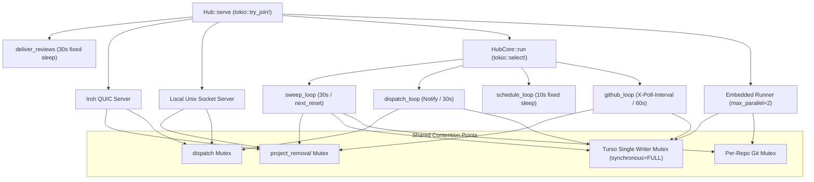

# Threadlane Hub: Task Inventory, Bottleneck Analysis & Effectiveness Plan

This document inventories every background task and execution path in `threadlane-hub` (along with its direct interactions with `threadlane-store`, `threadlane-runner`, `threadlane-transport-local`, and `threadlane-transport-iroh`), ranks the bottlenecks by user-visible impact and reliability risk, and lays out a phased plan to make the app fast, resilient, and scalable.

---

## 1. Architecture & Complete Inventory of Hub Tasks

`Hub::serve` ([node.rs](file:///Users/wheregmis/.gemini/antigravity/worktrees/mypi/threadlane_hub_bottlenecks_plan/crates/threadlane-hub/src/node.rs#L181-L281)) runs 5 top-level concurrent branches inside `tokio::try_join!`, one of which (`HubCore::run` in [core.rs](file:///Users/wheregmis/.gemini/antigravity/worktrees/mypi/threadlane_hub_bottlenecks_plan/crates/threadlane-hub/src/core.rs#L353-L361)) multiplexes 4 additional loops:

### Complete Task Inventory

| # | Task / Loop | Location | Trigger / Cadence | Primary Responsibility | Locks / Blocking I/O |
|---|---|---|---|---|---|
| 1 | **`deliver_reviews`** | [node.rs](file:///Users/wheregmis/.gemini/antigravity/worktrees/mypi/threadlane_hub_bottlenecks_plan/crates/threadlane-hub/src/node.rs#L116-L138) | Fixed `30s` `tokio::time::sleep` (not event-driven) | Publishes queued GitHub PR reviews via `gh api` (2 subprocesses/review) | Sequential `gh api`; **propagates DB errors with `?` into `try_join!`** |
| 2 | **`sweep_loop`** | [core.rs](file:///Users/wheregmis/.gemini/antigravity/worktrees/mypi/threadlane_hub_bottlenecks_plan/crates/threadlane-hub/src/core.rs#L375-L398) | `min(next_reset(), now + 30s)` | Expires stale leases, runs deleted-project cleanups, removes idle worktrees (3d TTL), posts account cooldown notices, wakes runners | Acquires `project_removal` across `git` checkpoints & recursive `rm`; always writes in `expire_leases` |
| 3 | **`dispatch_loop`** | [core.rs](file:///Users/wheregmis/.gemini/antigravity/worktrees/mypi/threadlane_hub_bottlenecks_plan/crates/threadlane-hub/src/core.rs#L400-L423), [dispatcher.rs](file:///Users/wheregmis/.gemini/antigravity/worktrees/mypi/threadlane_hub_bottlenecks_plan/crates/threadlane-hub/src/dispatcher.rs#L51-L218) | `WakeTarget::Dispatcher` or `min(next_delivery_after, 30s)` | Delivers outbox messages, quiet hours, digests, hourly rate limits, retry backoff | Holds `dispatch` mutex across sequential `channel.deliver().await` (no timeout) |
| 4 | **`schedule_loop`** | [core.rs](file:///Users/wheregmis/.gemini/antigravity/worktrees/mypi/threadlane_hub_bottlenecks_plan/crates/threadlane-hub/src/core.rs#L363-L373), [timers.rs](file:///Users/wheregmis/.gemini/antigravity/worktrees/mypi/threadlane_hub_bottlenecks_plan/crates/threadlane-hub/src/timers.rs#L456-L505) | Fixed `10s` sleep (`settings.scheduler`) | Fires due one-shot timers, recurring routines, and project Dreaming timers | Sequential per-timer DB write transactions |
| 5 | **`github_loop`** | [github.rs](file:///Users/wheregmis/.gemini/antigravity/worktrees/mypi/threadlane_hub_bottlenecks_plan/crates/threadlane-hub/src/github.rs#L602-L622) | `X-Poll-Interval` (or `60s`) | Polls GitHub notifications, lead PR activity, and active task PR checks/reviews/comments | Holds `github_poll` for entire pass; acquires `project_removal` twice; sequential `gh api` |
| 6 | **Embedded `Runner`** | [node.rs](file:///Users/wheregmis/.gemini/antigravity/worktrees/mypi/threadlane_hub_bottlenecks_plan/crates/threadlane-hub/src/node.rs#L330-L368), [runner.rs](file:///Users/wheregmis/.gemini/antigravity/worktrees/mypi/threadlane_hub_bottlenecks_plan/crates/threadlane-runner/src/runner.rs#L149-L196) | Startup, `Nudge`, lane finish, or `30s` poll; `20s` heartbeat | Claims up to `max_parallel=2` lanes, prepares git worktrees, drives Claude/Codex/AGY backends, mirrors journal events, executes tools | Per-repo mutex across `git fetch`; `2s` debounce; per-event `check_running` DB calls; `50ms` journal fsyncs |
| 7 | **Local Unix Socket Server** | [node.rs](file:///Users/wheregmis/.gemini/antigravity/worktrees/mypi/threadlane_hub_bottlenecks_plan/crates/threadlane-hub/src/node.rs#L228-L236), [lib.rs](file:///Users/wheregmis/.gemini/antigravity/worktrees/mypi/threadlane_hub_bottlenecks_plan/crates/threadlane-transport-local/src/lib.rs#L393-L423) | Per incoming Unix socket connection | Serves local desktop/CLI RPCs and `feed` long-polls | Strict sequential HOL blocking per connection; unbounded `read_until`; no server timeouts |
| 8 | **Iroh QUIC Server** | [node.rs](file:///Users/wheregmis/.gemini/antigravity/worktrees/mypi/threadlane_hub_bottlenecks_plan/crates/threadlane-hub/src/node.rs#L216-L227), [lib.rs](file:///Users/wheregmis/.gemini/antigravity/worktrees/mypi/threadlane_hub_bottlenecks_plan/crates/threadlane-transport-iroh/src/lib.rs#L377-L444) | Per QUIC bi-directional stream | Serves remote paired clients and `push_feed` streams | Spawns per-stream tasks; no write timeout; `60s` idle `push_feed` loop |
| 9 | **Auxiliary Tasks** | [node.rs](file:///Users/wheregmis/.gemini/antigravity/worktrees/mypi/threadlane_hub_bottlenecks_plan/crates/threadlane-hub/src/node.rs#L307-L317), [handler.rs](file:///Users/wheregmis/.gemini/antigravity/worktrees/mypi/threadlane_hub_bottlenecks_plan/crates/threadlane-hub/src/handler.rs#L338-L343), [updater.rs](file:///Users/wheregmis/.gemini/antigravity/worktrees/mypi/threadlane_hub_bottlenecks_plan/crates/threadlane-hub/src/updater.rs#L24-L36) | On demand / process lifetime | macOS `caffeinate` child, `spawn_blocking` image validation, `spawn_blocking` self-update | Safe / isolated |

---

## 2. Bottlenecks Ranked by Impact

### P0 — Critical (Reliability, Severe Contention, and Runaway Scaling)

#### 1. Fatal Crash & Abrupt Shutdown in `deliver_reviews`
- **Where:** [node.rs](file:///Users/wheregmis/.gemini/antigravity/worktrees/mypi/threadlane_hub_bottlenecks_plan/crates/threadlane-hub/src/node.rs#L116-L138), [node.rs](file:///Users/wheregmis/.gemini/antigravity/worktrees/mypi/threadlane_hub_bottlenecks_plan/crates/threadlane-hub/src/node.rs#L209-L215), [node.rs](file:///Users/wheregmis/.gemini/antigravity/worktrees/mypi/threadlane_hub_bottlenecks_plan/crates/threadlane-hub/src/node.rs#L273-L280)
- **What happens:** Unlike `HubCore`'s loops (which catch and log DB errors), `deliver_reviews` uses `?` on `self.db.pending_github_reviews().await?` and `delivered_github_review`. Because it lives inside `tokio::try_join!`, any transient DB error kills the entire hub. Worse, when `work` returns `Err`, `tokio::select!` returns immediately at line 274, bypassing `stop.send(true); work.await` — dropping the embedded runner abruptly without releasing leases or stopping in-flight runs.
- **Compounding issue:** Permanently failing reviews (deleted PR, 404/422) have no retry limit or backoff and execute 2 `gh api` subprocesses every 30s forever.

#### 2. Database Contention Storm: Unpooled Readers + Per-Token DB Queries + `synchronous = FULL` Fsyncs
- **Where:** [db.rs](file:///Users/wheregmis/.gemini/antigravity/worktrees/mypi/threadlane_hub_bottlenecks_plan/crates/threadlane-store/src/db.rs#L50-L92), [runner.rs](file:///Users/wheregmis/.gemini/antigravity/worktrees/mypi/threadlane_hub_bottlenecks_plan/crates/threadlane-runner/src/runner.rs#L663-L696), [link.rs](file:///Users/wheregmis/.gemini/antigravity/worktrees/mypi/threadlane_hub_bottlenecks_plan/crates/threadlane-hub/src/link.rs#L42-L63)
- **What happens:**
  - **Per-token DB storm:** Inside `mirror_events`, for **every single streamed `BackendEvent`** (every token/delta), the runner calls `self.link.check_running(&lane.lease()).await`. That runs `check_lease` (`db.lane`) + `db.check_running` (2 more queries), and because `Db::reader()` calls `self.database.connect()` on every read, **every streamed event opens 2 brand-new Turso connections and runs 3 SQL queries**.
  - **Global writer lock + fsync storm:** Every write serializes on `Db::writer: Mutex<Writer>` with `PRAGMA synchronous = FULL` (and no `WAL`, `busy_timeout`, or `cache_size` configured). Journal flushes fire every `50ms`, every `16` events, and on every `ToolUse`/`TurnBoundary`, forcing constant full-disk fsyncs that contend with `grant_lease`, `insert_event`, `mark_sent`, and UI RPCs.
  - **Wasteful write locks:** `expire_leases` acquires the writer lock and commits even when 0 leases expired; `grant_lease` runs ~10 sequential queries + an unconditional `UPDATE tasks` under the global writer lock even for lead lanes or denied leases (and leaves `needs_rollback = true` on early drops).

#### 3. Lock-Chain Convoy on `project_removal` and `dispatch`
- **Where:** [core.rs](file:///Users/wheregmis/.gemini/antigravity/worktrees/mypi/threadlane_hub_bottlenecks_plan/crates/threadlane-hub/src/core.rs#L258-L333), [handler.rs](file:///Users/wheregmis/.gemini/antigravity/worktrees/mypi/threadlane_hub_bottlenecks_plan/crates/threadlane-hub/src/handler.rs#L880-L897), [handler.rs](file:///Users/wheregmis/.gemini/antigravity/worktrees/mypi/threadlane_hub_bottlenecks_plan/crates/threadlane-hub/src/handler.rs#L951-L986), [dispatcher.rs](file:///Users/wheregmis/.gemini/antigravity/worktrees/mypi/threadlane_hub_bottlenecks_plan/crates/threadlane-hub/src/dispatcher.rs#L53-L217), [github.rs](file:///Users/wheregmis/.gemini/antigravity/worktrees/mypi/threadlane_hub_bottlenecks_plan/crates/threadlane-hub/src/github.rs#L325-L457)
- **What happens:**
  - `project_removal` is held across slow git checkpoints, recursive directory deletions, and `Routes::read` N+1 scans. It is shared by `DeleteProject` (UI RPC), `sweep_once` (liveness!), and `poll_github_once`.
  - `dispatch` is held across arbitrary `channel.deliver(&message).await` network I/O with **no timeout** (and `limit = u32::MAX` when pacing is non-default).
  - **Convoy:** `DeleteProject` acquires `project_removal` **then** `dispatch`. A hung/slow channel adapter wedges `dispatch` → wedges `DeleteProject` → wedges `project_removal` → halts `sweep_loop` (no lease expiry / runner wakes) and `github_loop`, while UI RPCs hit the 30s `REQUEST_TIMEOUT`.

#### 4. Missing Indexes & Monotonically Growing N+1 / Full-Table Scans
- **Where:** [github.rs](file:///Users/wheregmis/.gemini/antigravity/worktrees/mypi/threadlane_hub_bottlenecks_plan/crates/threadlane-hub/src/github.rs#L144-L242), [inbox.rs](file:///Users/wheregmis/.gemini/antigravity/worktrees/mypi/threadlane_hub_bottlenecks_plan/crates/threadlane-store/src/inbox.rs#L453-L472), [overview.rs](file:///Users/wheregmis/.gemini/antigravity/worktrees/mypi/threadlane_hub_bottlenecks_plan/crates/threadlane-hub/src/handler/overview.rs#L137-L202), [work.rs](file:///Users/wheregmis/.gemini/antigravity/worktrees/mypi/threadlane_hub_bottlenecks_plan/crates/threadlane-store/src/work.rs#L191-L235)
- **Worst offenders:**
  - **`Routes::read`** ([github.rs](file:///Users/wheregmis/.gemini/antigravity/worktrees/mypi/threadlane_hub_bottlenecks_plan/crates/threadlane-hub/src/github.rs#L144-L242)): Runs `1 + 2P + T` queries (calling `db.lane_decisions` for **every non-cancelled historical task**) and is invoked **up to 3 times per GitHub poll** (twice while holding `project_removal`).
  - **Missing SQLite indexes** causing full table scans on hot paths:
    - `events(status)` missing → `ready_lanes` scans all `lanes` every sweep/placement.
    - `lanes(lease_expires_at) WHERE lease_owner IS NOT NULL` missing → `expire_leases` cannot range-seek.
    - `events(lane_id, kind, received_at, id)` & `events(project_id, kind, received_at)` missing → `Conversation` scans & filesorts.
    - `outbox(channel, status, sent_at, delivery_seq)` missing → `sent_before` scans & filesorts; `account_notice` uses `LIKE 'system:account:%'` under the global writer lock.
    - `runs(started_at)`, `runs(session_id)`, `decisions(status)`, `tasks(status)`, `timers(lane_id)`, `task_dependencies(depends_on)` all missing.
    - `space_usage` full-scans `runs` and parses JSON across `journal` with `json_extract` even though `runs.usage` column exists.
  - **UI N+1 & unbounded loads:**
    - `OverviewRequest::Work` / `Tasks` / `Running`: 2N queries per active/in-review task (`active_lane_run` + `latest_journal_entry`).
    - `OverviewRequest::Task`: Loads **all** runs and **full** `journal` for every run + scans **all** project tasks to find `related`.
    - `OverviewRequest::LeadRuns` & `Agenda`, `OrgRequest::Bindings`, `DecisionRequest::Pending` / `StandingRules`, `ClientApi::read_feed` (reloads all projects + N+1 `digest_originals` on every poll), `OrgRequest::AddRepository` (runs `git config` subprocess per existing repo across all projects).

---

### P1 — High (Perceived Responsiveness, Token/Cache Efficiency, and Throughput)

#### 5. High Turn & Task Startup Latency
- **Flat 2-second debounce** ([runner.rs](file:///Users/wheregmis/.gemini/antigravity/worktrees/mypi/threadlane_hub_bottlenecks_plan/crates/threadlane-runner/src/runner.rs#L323-L336)): Every `UserMessage` and `TaskResult` sleeps 2s before `begin_run` even starts, and fetches full `Event` payloads (including base64 images) just to check `kind`.
- **Low default concurrency** ([config.rs](file:///Users/wheregmis/.gemini/antigravity/worktrees/mypi/threadlane_hub_bottlenecks_plan/crates/threadlane-runner/src/config.rs#L7-L13)): `DEFAULT_MAX_PARALLEL = 2` is shared across **both** lead lanes and task lanes. Two running tasks completely starve the interactive Lead chat!
- **Double & redundant `git fetch origin`** ([workspace.rs](file:///Users/wheregmis/.gemini/antigravity/worktrees/mypi/threadlane_hub_bottlenecks_plan/crates/threadlane-runner/src/workspace.rs#L165-L210), [runner.rs](file:///Users/wheregmis/.gemini/antigravity/worktrees/mypi/threadlane_hub_bottlenecks_plan/crates/threadlane-runner/src/runner.rs#L398)): On a new task's first run, `prepare` runs `git fetch origin` and milliseconds later `bring_in_base` runs a **second** `git fetch origin` under the per-repo mutex. Every subsequent run and `finish_task` / `publish_branch` tool call also runs synchronous network `git fetch`.
- **Heavy `begin_run` critical path** ([begin_run.rs](file:///Users/wheregmis/.gemini/antigravity/worktrees/mypi/threadlane_hub_bottlenecks_plan/crates/threadlane-hub/src/begin_run.rs#L54-L499)): Runs 18–30+ sequential DB queries with multiple N+1 loops (`choose_batch` → `route`, `space_lead::summary` loading all historical tasks per project, `answered_ask` called twice, redundant `db.decision` / `db.bindings` / `db.machine`).
- **Synchronous 30s LLM screening in `begin_run`** ([begin_run.rs](file:///Users/wheregmis/.gemini/antigravity/worktrees/mypi/threadlane_hub_bottlenecks_plan/crates/threadlane-hub/src/begin_run.rs#L171-L199), [review.rs](file:///Users/wheregmis/.gemini/antigravity/worktrees/mypi/threadlane_hub_bottlenecks_plan/crates/threadlane-hub/src/review.rs#L60-L106)): Screens each `Trust::External` event sequentially with a 30s timeout (`30s × K`).

#### 6. Prompt Cache Busting & Unbounded Prompt Growth
- **Where:** [begin_run.rs](file:///Users/wheregmis/.gemini/antigravity/worktrees/mypi/threadlane_hub_bottlenecks_plan/crates/threadlane-hub/src/begin_run.rs#L378-L383), [space_lead.rs](file:///Users/wheregmis/.gemini/antigravity/worktrees/mypi/threadlane_hub_bottlenecks_plan/crates/threadlane-hub/src/space_lead.rs#L67-L107), [context.rs](file:///Users/wheregmis/.gemini/antigravity/worktrees/mypi/threadlane_hub_bottlenecks_plan/crates/threadlane-hub/src/context.rs#L152-L206)
- **What happens:** `space_lead::summary` injects every project's live open-task list and latest message into the General lead's `appended_instructions` (system prompt). Any change in any project invalidates the LLM's prefix/prompt cache on every General lead turn, dramatically increasing TTFT and token cost. Additionally, `render_prompt` and `loaded_memory` have no byte/token caps.

#### 7. Tool Gateway Overhead
- **Where:** [tools.rs](file:///Users/wheregmis/.gemini/antigravity/worktrees/mypi/threadlane_hub_bottlenecks_plan/crates/threadlane-hub/src/tools.rs#L1316-L1335), [tools.rs](file:///Users/wheregmis/.gemini/antigravity/worktrees/mypi/threadlane_hub_bottlenecks_plan/crates/threadlane-hub/src/tools.rs#L1457-L1472), [gateway.rs](file:///Users/wheregmis/.gemini/antigravity/worktrees/mypi/threadlane_hub_bottlenecks_plan/crates/threadlane-hub/src/gateway.rs#L37-L286)
- **What happens:**
  - `HubTools::definition(name)` rebuilds all ~30 `ToolDefinition` JSON schemas from scratch; `CombinedTools` calls it **2–3 times per tool call**.
  - Every tool call executes 10–14 sequential DB queries (fetching `standing_rules` even for `Tier::Read`/`Tier::Local` tools, and re-fetching `run` and `run_events` inside `HubTools::execute` and `review::classify` even though `gateway()` already loaded them).
  - `assign_issue` blocks synchronously on live `gh api` calls (`publish.rs:363-437`), and `Verdict::Review` blocks synchronously for up to 30s on `backend.ask()`.

#### 8. Serial GitHub Polling & Unbounded Pagination
- **Where:** [github.rs](file:///Users/wheregmis/.gemini/antigravity/worktrees/mypi/threadlane_hub_bottlenecks_plan/crates/threadlane-hub/src/github.rs#L435-L561), [gh.rs](file:///Users/wheregmis/.gemini/antigravity/worktrees/mypi/threadlane_hub_bottlenecks_plan/crates/threadlane-hub/src/gh.rs#L135-L363)
- **What happens:** Every PR and every endpoint (`check-runs`, `reviews`, `comments`, `events`) is polled strictly sequentially via `gh` subprocesses. Worse, `GhSource::latest_item` has **no `MAX_PAGES` cap**, so an active PR with hundreds of comments/events can stall `github_loop` for minutes. `issue_claim` also re-fetches `gh api user` every time without caching.

#### 9. Wakeup Gaps, Polling Jitter & Thundering Herds
- **`deliver_reviews`** sleeps a fixed 30s (no wake when a review is queued).
- **`schedule_loop`** sleeps a fixed 10s (no `next_due_timer()` sleep target, no wake on timer creation).
- **`dispatch_once`** calls `wake.delivered()` **per message** regardless of channel, waking all `feed` clients $M$ times per batch (and even for non-client channels); also stalls >100-message unpaced bursts for up to 30s because `next_delivery_after(started_at)` skips items with `not_before <= started_at`.
- **`ClientApi::feed`** executes a redundant `read_feed` DB query on every 60s idle timeout, and hangs until `deadline` if the `watch` sender closes on shutdown.
- **`LocalClient::exchange`** opens a fresh Unix domain socket connection for every single RPC.

---

### P2 — Medium (Operational Hygiene & Transport Hardening)

- **`remove_idle_worktrees` cadence** ([core.rs](file:///Users/wheregmis/.gemini/antigravity/worktrees/mypi/threadlane_hub_bottlenecks_plan/crates/threadlane-hub/src/core.rs#L246-L314)): Runs every 30s inside `sweep_once` for a 3-day idle threshold, doing directory walks + `db.task` + `db.lane_runs` for every worktree every 30s.
- **Blocking `std::fs` on async workers** ([memory_check.rs](file:///Users/wheregmis/.gemini/antigravity/worktrees/mypi/threadlane_hub_bottlenecks_plan/crates/threadlane-hub/src/memory_check.rs#L63-L72)): `canonicalize`/`exists`/`is_dir` run directly on Tokio workers alongside sequential `git ls-tree` and an $O(N^2 \times W)$ note comparison.
- **Transport hardening**:
  - `transport-local` has unbounded `read_until(b'\n')` (OOM hazard) and no server read/write timeouts.
  - `IrohClient::connection()` holds `tokio::sync::Mutex<State>` across a 10s `dial().await`, stalling all concurrent RPCs during reconnects.
  - Hard 30s `REQUEST_TIMEOUT` on both transports prematurely times out slow operations (`DeleteProject`, `CheckMemory`, `AddRepository`), while the hub keeps running them.
- **Dreaming thundering herd** ([dreaming.rs](file:///Users/wheregmis/.gemini/antigravity/worktrees/mypi/threadlane_hub_bottlenecks_plan/crates/threadlane-hub/src/dreaming.rs#L333-L352)): All projects default to the exact same daily dreaming time, firing simultaneous LLM runs.
- **Sequential startup probes** ([runner.rs](file:///Users/wheregmis/.gemini/antigravity/worktrees/mypi/threadlane_hub_bottlenecks_plan/crates/threadlane-runner/src/runner.rs#L92-L103)): Probing Claude, Codex, Antigravity, and `gh auth status` runs serially instead of concurrently.

---

## 3. Phased Plan to Make Threadlane Hub Highly Effective

### Phase 1: Stop the Bleeding (Reliability, DB Contention & Lock Separation)
*Highest ROI — eliminates crashes, writer-lock stalls, and the per-token DB storm.*

1. **Fix `deliver_reviews` crash & abrupt shutdown (`node.rs`)**:
   - Catch and log DB errors inside `deliver_reviews` instead of propagating `?` into `try_join!`.
   - Add per-review retry count + exponential backoff + dead-letter/terminal state for 4xx/permanent GitHub errors, and wake it via `WakeHub` when a review is queued instead of waiting 30s.
   - In `Hub::serve`, on `work` error, still broadcast `stop.send(true)` so sibling tasks (especially the embedded runner) flush and release leases gracefully.
2. **Eliminate the per-token `check_running` DB storm (`runner.rs`, `link.rs`)**:
   - Stop calling `self.link.check_running()` on every streamed `BackendEvent`. Check only on `TurnBoundary`, `ToolUse`, or a throttled interval (e.g., every `500ms–1s`), plus rely on the existing `lane.stopped()` watch channel for immediate local stops.
   - Remove redundant pre-check `check_lease` reads in `LocalLink` where the store transaction already validates the lease.
3. **Configure Turso properly & pool readers (`threadlane-store/src/db.rs`, `inbox.rs`)**:
   - Configure `PRAGMA journal_mode = WAL`, `PRAGMA busy_timeout = 5000`, `PRAGMA temp_store = MEMORY`, and a sensible `cache_size` on open. Evaluate `PRAGMA synchronous = NORMAL` under WAL (or keep `FULL` for durability-critical commits while batching journal appends to `250ms–500ms`).
   - Cache/pool reader `Connection` handles instead of calling `self.database.connect()` on every query.
   - Short-circuit `expire_leases` with a read check before acquiring `Db::writer`; move read-only eligibility checks in `grant_lease` before acquiring the write lock, and only `UPDATE tasks` when `waiting_reason` actually changes.
4. **Break the `project_removal` / `dispatch` lock-chain convoy (`core.rs`, `handler.rs`, `dispatcher.rs`)**:
   - Decouple **liveness** (`expire_leases`, `notice_accounts`, runner wakes) from **disk maintenance** (`cleanup_project`, `remove_idle_worktrees`) by moving worktree/project cleanup to a dedicated low-frequency background task (e.g., every 15–30 minutes + woken on `DeleteProject`).
   - Make `DeleteProject` commit the DB deletion synchronously (fast!), return immediately to the UI, and let the background cleanup task remove worktrees/clones asynchronously without holding `project_removal` across `dispatch`.
   - Never hold `inner.dispatch` across `channel.deliver(&message).await` (claim a batch in DB, drop lock, deliver with a per-message timeout, then update status).

### Phase 2: Database Indexes & Query Optimization
*Turns O(N)/O(N²) growth into O(log N) so the app stays fast after thousands of tasks and months of history.*

1. **Add a migration with targeted SQLite indexes (`crates/threadlane-store/migrations/`)**:
   - `CREATE INDEX events_pending_lane ON events(lane_id, id, trust) WHERE status = 'pending';` (speeds up `ready_lanes`)
   - `CREATE INDEX lanes_active_lease ON lanes(lease_expires_at) WHERE lease_owner IS NOT NULL;` (speeds up `expire_leases`)
   - `CREATE INDEX events_lane_kind_time ON events(lane_id, kind, received_at DESC, id DESC);` (speeds up `user_messages`)
   - `CREATE INDEX events_project_kind_time ON events(project_id, kind, received_at DESC);` (speeds up `delivery_failures` & `project_outputs`)
   - `CREATE INDEX outbox_channel_sent ON outbox(channel, status, sent_at DESC, delivery_seq DESC);` (speeds up `sent_before`)
   - `CREATE INDEX runs_started_at ON runs(started_at);` and `CREATE INDEX runs_session_id ON runs(session_id);`
   - `CREATE INDEX decisions_status ON decisions(status, id);`
   - `CREATE INDEX tasks_status ON tasks(status);`
   - `CREATE INDEX timers_lane_id ON timers(lane_id);`
   - `CREATE INDEX task_dependencies_depends_on ON task_dependencies(depends_on);`
   - Replace `LIKE 'system:account:%'` in `account_notice` with a range predicate (`>= 'system:account:' AND < 'system:account;'`) or a dedicated column/index so it uses the index.
   - Populate and read `runs.usage` directly instead of scanning `journal` with `json_extract` in `space_usage`.
2. **Eliminate the worst N+1 queries**:
   - **`Routes::read` (`github.rs`)**: Replace `1 + 2P + T` queries with a single SQL join returning only tasks with active/open PRs (and cache/reuse the snapshot within a single poll pass instead of calling it 3x).
   - **UI Overview (`overview.rs`, `handler.rs`)**: Add batch store queries (`active_runs_with_latest_journal(lane_ids)`, `project_timers_all()`, `digest_originals_batch(ids)`, `task_related(task_id)`, `project_by_name(name)`, `agent_by_name(name)`).
   - **Bounded loads**: Add `LIMIT`/pagination to `OverviewRequest::LeadRuns`, `inspect_lane`, `lane_decisions` (replace `.iter().any(...)` with `EXISTS` queries), and `memory_files` listing (select metadata/paths without `content` when only listing paths).

### Phase 3: Snappy UX, Faster Runs & Token Efficiency
*Directly improves perceived speed, agent responsiveness, and API cost.*

1. **Separate Lead vs. Task concurrency & shrink debounce (`runner.rs`, `config.rs`)**:
   - Reserve dedicated slot(s) for interactive **Lead lanes** (e.g., `max_parallel_tasks = 2–4` + `max_parallel_leads = 2`) so background tasks never starve user chat.
   - Lower default debounce from `2s` to `200–350ms` for `UserMessage` (or `0ms` when no rapid follow-up is expected) and use a metadata-only query (omitting `payload`) in `debounce` and `fold_in`.
2. **Coalesce & deduplicate `git fetch` (`workspace.rs`, `runner.rs`)**:
   - Remove the duplicate `git fetch origin` between `prepare` and `bring_in_base` on first run.
   - Add a per-repo fetch timestamp TTL (e.g., `15–30s`) + in-flight fetch coalescing (`singleflight`) so concurrent tasks on the same repo share one fetch instead of serializing behind the per-repo mutex.
   - Parallelize multi-repo operations (`futures::future::try_join_all`) and startup backend/`gh` probes (`tokio::join!`).
3. **Streamline `begin_run` & Tool Gateway (`begin_run.rs`, `tools.rs`, `gateway.rs`, `context.rs`)**:
   - Cache `HubTools::definitions()` in a `OnceLock<Vec<ToolDefinition>>` + `HashMap<&'static str, usize>` index (zero schema allocations per tool call).
   - Pass already-loaded `Run`, `Vec<Event>`, and `Task` from `gateway()` into `gate()`, `HubTools::execute()`, and `review::classify()`, and skip `standing_rules` DB lookup for `Tier::Read`/`Tier::Local` tools.
   - Parallelize independent `begin_run` reads (`tokio::try_join!`) and external-event screening (`buffer_unordered(4)`).
4. **Protect LLM prompt caching (`space_lead.rs`, `begin_run.rs`, `context.rs`)**:
   - Move volatile `space_lead::summary` (open tasks / latest messages) out of `appended_instructions` (system prompt) into the dynamic user turn / `<context>` block so the General lead's system prompt stays cache-stable across turns.
   - Add explicit character/token budgets and truncation for `loaded_memory`, `progress`, and `recent_messages`.

### Phase 4: Event-Driven Loops, Parallel GitHub Polling & Transport Polish
*Makes background work quiet when idle and fast under load.*

1. **Make all loops event-driven & fix wake storms (`core.rs`, `dispatcher.rs`, `handler.rs`, `timers.rs`)**:
   - **`schedule_loop`**: Sleep until `min(db.next_due_timer(), now + 60s)` and wake via `WakeHub` whenever a timer is created/updated/resumed.
   - **`dispatch_loop`**: Call `wake.delivered()` **once per pass** (only if ≥1 `CLIENT_CHANNEL` message was sent); if a batch hit `BATCH = 100`, loop immediately without sleeping 30s.
   - **`ClientApi::feed`**: Check `clock.now() >= deadline` before re-querying on timeout; return immediately if the `watch` channel closes.
   - **Stagger Dreaming schedules**: Add a deterministic per-project jitter (e.g., hash of `project_id` mod 30 min) so projects don't fire simultaneous LLM runs.
2. **Parallelize & cap GitHub polling (`github.rs`, `gh.rs`)**:
   - Poll active PRs with bounded concurrency (`futures::stream::iter(...).buffer_unordered(4)`) and fetch `check-runs`, `reviews`, and `comments` concurrently per PR via `tokio::try_join!`.
   - Add `MAX_PAGES` cap to `GhSource::latest_item` and cache `gh api user` login.
   - Wake `github_loop` immediately when `gh_login` transitions to `true`.
3. **Harden Transports (`threadlane-transport-local`, `threadlane-transport-iroh`)**:
   - Add a `MAX_LINE_BYTES` cap and server read/write timeouts to `transport-local`, plus a small client connection pool or multiplexed framing.
   - Release `IrohClient`'s state mutex before awaiting `dial()` (use a `OnceCell`/in-flight connect future or `watch` channel) so reconnects don't stall all callers.
   - Support per-RPC timeouts (or make slow RPCs like `DeleteProject` / `CheckMemory` asynchronous/streaming).

---

## 4. Verification & Measurement Strategy

Because `crates/threadlane-benchmarks` already exists in the workspace, each phase can be validated quantitatively:
- **DB & Write Contention**: Measure p50/p99 latency of `send_message`, `append_journal`, and `OverviewRequest::Work` under 4 active simulated runs streaming 50 events/sec.
- **Turn Startup Latency**: Measure wall-clock time from `send_message` to first backend invocation (target: `< 400ms` for Lead turns, down from `> 2.5s` with debounce + N+1 `begin_run`).
- **GitHub Poll Scaling**: Benchmark `Routes::read` and `poll_github_once` with 10 projects, 1,000 historical tasks, and 10 active PRs.
- **Reliability**: Add an integration test verifying that a transient DB error in `deliver_reviews` does not terminate `Hub::serve`, and that `DeleteProject` returns in `< 200ms` even while `remove_idle_worktrees` or a slow channel adapter is active.
